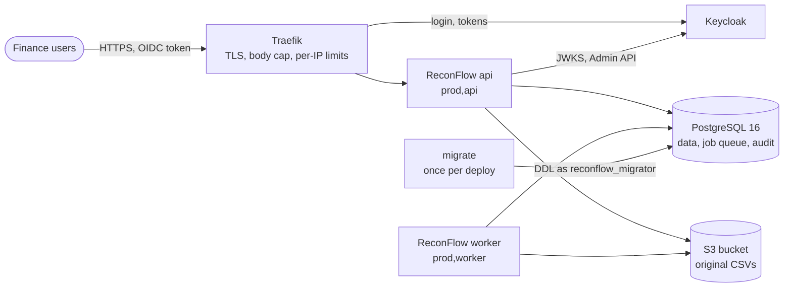

# ReconFlow

[](https://github.com/kasalmanfarcy/PaymentReconciliation/actions/workflows/ci.yml)
[](LICENSE)

**A business's ledger says a payment arrived; the payment gateway's settlement file says something
else.** ReconFlow imports both, matches them with deterministic rules, turns every disagreement into
a case an investigator can work, and records who resolved what, and why, in an append-only audit
trail. Multi-tenant, built as a Spring Boot modular monolith on PostgreSQL.

> **Status: v1 complete (M0–M11).** Everything in [TASKS.md](TASKS.md) through M11 is built, tested
> and documented, including a production deployment that has been rehearsed end to end on a laptop.
> Not yet done, because each needs an account or a person: the live deployment, the GitHub
> repository settings and a recorded demo GIF ([what's left](#whats-left-for-the-owner)).

```text
$ ./scripts/demo.sh
▶ Uploading the gateway settlement file (22 rows, 2 of them malformed)
  gateway: {"status":"COMPLETED_WITH_ERRORS","totalRows":22,"validRows":20,"errorRows":2}
▶ Reconciling AED, 12-13 October 2026
  matched: count 13, amount 13410.1400
  amountMismatch: count 2, netDifference -500.0300
  unmatchedLeft: count 2, amount 602.0000
  ✓ summary identical to expected.json
▶ Resolving DEMO-302 (ledger 2500.00, gateway 2000.00) as GATEWAY_FEE, with If-Match
  ✓ resolved
▶ The same resolve again with the old ETag: a concurrent edit must not win silently
  HTTP 409 stale-version
Demo complete: every number matched docs/samples/demo/expected.json.
```
<sub>An excerpt of a real run (trimmed). The full walkthrough also logs in three roles, lists the work queue, prints the report and the case's audit trail.</sub>

---

## Quick start

You need Docker (Docker Desktop, OrbStack or Colima), `curl`, `jq` and `openssl`. No Java, no Maven.

```bash
git clone https://github.com/kasalmanfarcy/PaymentReconciliation.git && cd PaymentReconciliation
./scripts/demo.sh
```

The first run builds the image (a few minutes), starts PostgreSQL, MinIO, Keycloak and the app
(`docker compose --profile full`), then walks the demo and checks every number. Run it again: the
uploads are recognised as duplicates and the second run gives the same summary.
`docker compose --profile full down -v` removes everything.

> **Colima:** export `DOCKER_HOST=unix://$HOME/.colima/default/docker.sock` first, and install the
> Buildx plugin the image build needs (`brew install docker-buildx`, then link it into
> `~/.docker/cli-plugins`, as [Development](#development) shows).

---

## What it does

ReconFlow answers four questions:

1. **Which transactions match?** Same normalized reference, transaction type, currency and amount.
2. **Which don't?** Missing on either side, amount mismatches, duplicates, currency mismatches; never
   a silent best guess.
3. **Why?** Each discrepancy is a case with a type, a reason and both sides' records, raw and
   normalized.
4. **Who resolved it, and how?** Assignment, notes, resolution codes and reopening, all audited.

| Reference | Internal ledger | Gateway file | Result |
|---|---|---|---|
| DEMO-001 | 1,250.00 AED | 1,250.00 AED | Matched |
| ` demo-013 ` | 180.5 aed | DEMO-013, 180.50 AED | Matched (normalized) |
| DEMO-101 | 560.00 | — | `MISSING_IN_GATEWAY` |
| DEMO-302 | 2,500.00 | 2,000.00 | `AMOUNT_MISMATCH`, −500.00 |
| DEMO-401 | 450.00 | 450.00 ×2 | `DUPLICATE_IN_SOURCE` |
| DEMO-501 | 400.00 AED | 108.92 USD | `CURRENCY_MISMATCH` |

From the [demo dataset](docs/samples/demo/README.md). The rules (normalization N1–N11, participation,
ordered outcomes, discrepancy keys) are in [reconciliation-rules.md](docs/reconciliation-rules.md).

---

## Architecture at a glance



One jar, three roles chosen by profile. The api accepts uploads and run requests with `202 Accepted`
and writes jobs to a PostgreSQL table; workers claim them with `FOR UPDATE SKIP LOCKED`, leases and
heartbeats. Inside, nine modules (`ingestion`, `ledger`, `reconciliation`, `exceptions`, `reporting`,
`audit`, `organization`, `security`, `shared`) with boundaries enforced by Spring Modulith.
Details: [docs/architecture.md](docs/architecture.md).

---

## Engineering highlights

Each claim links to the code or test that proves it.

- **Idempotent everywhere.** A re-uploaded file is `409` by a SHA-256 unique constraint
  ([ADR 0005](docs/adr/0005-duplicate-import-policy.md), [DuplicateImportIT](src/test/java/com/reconflow/paymentreconflow/ingestion/DuplicateImportIT.java));
  a repeated run request returns the same run ([ADR 0006](docs/adr/0006-reconciliation-run-idempotency.md));
  a re-run never duplicates an active case ([RerunIT](src/test/java/com/reconflow/paymentreconflow/reconciliation/RerunIT.java)).
  A property test checks every record ends up in exactly one place
  ([EveryRecordInExactlyOnePlaceIT](src/test/java/com/reconflow/paymentreconflow/reconciliation/EveryRecordInExactlyOnePlaceIT.java)).
- **Set-based matching in SQL**, orchestrated from Java a day at a time with a checkpoint
  ([ADR 0012](docs/adr/0012-set-based-matching-in-sql.md), [classify_groups.sql](src/main/resources/sql/reconciliation/classify_groups.sql)):
  50,000 × 50,000 records reconciled in **6.5 s** (median of 3, [benchmarks §2.3](docs/benchmarks.md)).
- **Streaming imports** in 5,000-row transactions with a resume checkpoint: 500,000 rows in **14 s**
  under a 256 MB heap ([benchmarks §2.5](docs/benchmarks.md)).
- **Optimistic locking** on cases with `ETag`/`If-Match` (`428` when missing, `409` when stale): 50
  users resolving the same 10 cases got exactly 10 × `200` and 40 × `409`
  ([benchmarks §3, S6](docs/benchmarks.md), [ExceptionConcurrencyIT](src/test/java/com/reconflow/paymentreconflow/exceptions/ExceptionConcurrencyIT.java)).
- **Tenant isolation in three layers:** membership check per request, `organization_id` in every
  query, PostgreSQL row-level security for an application role that can't bypass it
  ([ADR 0008](docs/adr/0008-tenant-isolation.md), [CrossTenantIT](src/test/java/com/reconflow/paymentreconflow/tenancy/CrossTenantIT.java),
  [AppRolePrivilegesIT](src/test/java/com/reconflow/paymentreconflow/tenancy/AppRolePrivilegesIT.java)).
- **Transactional, append-only audit:** written in the caller's transaction, protected by triggers
  and revoked privileges ([AuditAppendOnlyIT](src/test/java/com/reconflow/paymentreconflow/audit/AuditAppendOnlyIT.java)).
- **A PostgreSQL job queue that survives crashes:** leases, heartbeats, a sweeper, backoff; a real
  `SIGKILL` mid-import resumes from its checkpoint with no row twice
  ([ADR 0004](docs/adr/0004-postgresql-job-queue.md), [FailureInjectionIT](src/test/java/com/reconflow/paymentreconflow/reliability/FailureInjectionIT.java),
  [benchmarks §4](docs/benchmarks.md)). Kafka was measured unnecessary ([ADR 0014](docs/adr/0014-no-kafka-in-v1.md)).
- **Delegated authentication:** built in-house first to learn it, then moved to Keycloak over OIDC
  with changes confined to the security package ([ADR 0015](docs/adr/0015-delegate-authentication-to-keycloak.md)).
- **Shipped like production:** non-root layered image, migrations as their own deploy step with their
  own credentials, a TLS edge with body caps and per-IP limits ([runbook](docs/runbooks/deploy.md));
  every control and its test in [docs/security.md](docs/security.md).

---

## API

- **Contract:** [docs/openapi.json](docs/openapi.json), generated from the controllers and checked
  in CI against the code and [api-design.md](docs/api-design.md) (`OpenApiSpecIT`).
- **Swagger UI:** `http://localhost:8080/swagger-ui.html` when the app runs with the `local` profile
  ([Development](#development)); off in `prod`.
- **Walkthrough as requests:** the [Bruno collection](bruno/) (`npx @usebruno/cli@4.2.1 run --env local
  --env-var demoPassword=reconflow-local-demo` from `bruno/`).

Uploads and runs are asynchronous (`202` and a `Location` to poll); errors are RFC 9457 problem
details with a stable `code` and the `requestId`; lists paginate (`page`, `size` ≤ 200). The endpoint
index with permissions is [api-design.md §8.1](docs/api-design.md#81-index).

---

## Development

**Prerequisites:** Java 25, Docker with Compose and Buildx. No Maven (`./mvnw`).

```bash
cp .env.example .env                 # local, clearly fake credentials
docker compose up -d                 # PostgreSQL 16, MinIO, Keycloak (realm imported from git)
SPRING_PROFILES_ACTIVE=local,api,worker ./mvnw spring-boot:run
```

On **Colima**, Docker and Testcontainers need to be told where the socket is, and the image build
needs the Buildx plugin:

```bash
export DOCKER_HOST=unix://$HOME/.colima/default/docker.sock
export TESTCONTAINERS_DOCKER_SOCKET_OVERRIDE=/var/run/docker.sock
brew install docker-buildx docker-compose
mkdir -p ~/.docker/cli-plugins
ln -sfn "$(brew --prefix)/opt/docker-buildx/bin/docker-buildx" ~/.docker/cli-plugins/docker-buildx
ln -sfn "$(brew --prefix)/opt/docker-compose/bin/docker-compose" ~/.docker/cli-plugins/docker-compose
```

**Log in (local).** Keycloak issues every token; ReconFlow only validates them. The local realm has
demo accounts with the documented password `reconflow-local-demo` (local only):
`admin|investigator|uploader|viewer@acme.test` (Acme Payments) and `@globex.test` (Globex Retail),
`consultant@both.test` (in both: send `X-Organization-Id`) and `platform@reconflow.test`.

```bash
TOKEN=$(curl -s localhost:8180/realms/reconflow/protocol/openid-connect/token -d grant_type=password \
  -d client_id=reconflow-demo -d username=admin@acme.test -d password=reconflow-local-demo | jq -r .access_token)
curl -s localhost:8080/api/v1/members -H "Authorization: Bearer $TOKEN" | jq
```

**Test.**

```bash
./mvnw test           # unit tests (*Test), no Docker
./mvnw verify         # + integration tests (*IT, Testcontainers PostgreSQL, MinIO, Keycloak), Spotless, JaCoCo
./mvnw spotless:apply # format before committing
```

**Profiles.** Environment: `local` (reads `.env`, readable logs, migrates on startup), `prod`
(environment variables only, JSON logs, validates the schema instead of migrating), `test`. Role:
`api`, `worker`, `migrate` (applies migrations and exits). `demo` seeds the demo organizations under
`prod` config. There is deliberately no default profile.

**Database roles.** The app connects as `reconflow_app` (data only; row-level security applies),
Flyway as `reconflow_migrator` (owns the schema); the superuser is for humans
([bootstrap-roles.sql](infra/db/bootstrap-roles.sql)). Compose creates both on first start; an older
volume needs `docker compose down -v` or the script run once by hand.

**Observe and measure.** `docker compose --profile observability up -d` adds Prometheus (`:9090`) and
Grafana (`:3000`, provisioned dashboard and alerts); the app's metrics are on the management port
8081, never the public one. Benchmarks, load scenarios and chaos scripts: [docs/benchmarks.md](docs/benchmarks.md).

**Deploy.** One VM with Docker Compose behind Traefik, a managed PostgreSQL 16 and an S3 bucket; CI
pushes `ghcr.io/kasalmanfarcy/reconflow:sha-<commit>` from `main`. Rehearse it locally with no
account: [docs/runbooks/deploy.md](docs/runbooks/deploy.md) §9.

---

## Project docs

| Document | Contents |
|---|---|
| [requirements.md](docs/requirements.md) | Problem, personas, functional and non-functional requirements, CSV contracts |
| [reconciliation-rules.md](docs/reconciliation-rules.md) | Normalization, matching, outcomes, discrepancy keys, state machines |
| [architecture.md](docs/architecture.md) | Context, containers, modules, flows, data model, deployment |
| [database-design.md](docs/database-design.md) | Tables, constraints, partitioning, tenancy, migrations |
| [api-design.md](docs/api-design.md) | Conventions, error catalogue, idempotency, concurrency, endpoints |
| [security.md](docs/security.md) | Every security control, its threat, enforcement and proof |
| [scalability.md](docs/scalability.md) | Capacity plan and SLOs |
| [benchmarks.md](docs/benchmarks.md) | Measured numbers only |
| [adr/](docs/adr/) | 15 Architecture Decision Records |
| [runbooks/](docs/runbooks/) | Deploy, restore drill, archival, default partition |
| [plans/](plans/README.md) | How each phase was built, and where the code differs from the plan |

---

## Roadmap

| Phase | Scope | Status |
|---|---|---|
| M0–M2 | Repository, requirements and design, project foundation | Done |
| M3–M4 | Organizations, users, tenant isolation; append-only audit | Done |
| M5–M8 | Ingestion, reconciliation engine, exception workflow, reporting | Done |
| M9 | Reliability and performance (recovery, benchmarks, metrics) | Done |
| M10 | Security hardening (Keycloak, DB roles, scanning, rate limits) | Done |
| M11 | Deployment and portfolio | Done (live deployment: owner step) |
| v2 | Many-to-one matching, fees, bank statements, a web UI, … | [Planned](plans/phase-v2-later-scope.plan) |

### What's left for the owner

These need an account, a machine or a person, so they were prepared but not done:

- **Deploy** to a VM with a managed PostgreSQL and a bucket: [runbook](docs/runbooks/deploy.md) §2–§4,
  then switch on the [deploy workflow](.github/workflows/deploy.yml).
- **GitHub settings:** Dependabot, secret scanning and push protection, required checks
  (`build`, `image`, `dependency-review`, `gitleaks`), `NVD_API_KEY` ([security.md §3](docs/security.md#3-steps-that-live-outside-the-repository)),
  and making the GHCR package public after the first push.
- **A demo GIF** for this page: `asciinema rec` of `./scripts/demo.sh`, converted with `agg`
  (TASKS.md M11.12).

---

[TASKS.md](TASKS.md) lists every task · [CONTRIBUTING.md](CONTRIBUTING.md) the conventions ·
Apache-2.0 [LICENSE](LICENSE)
