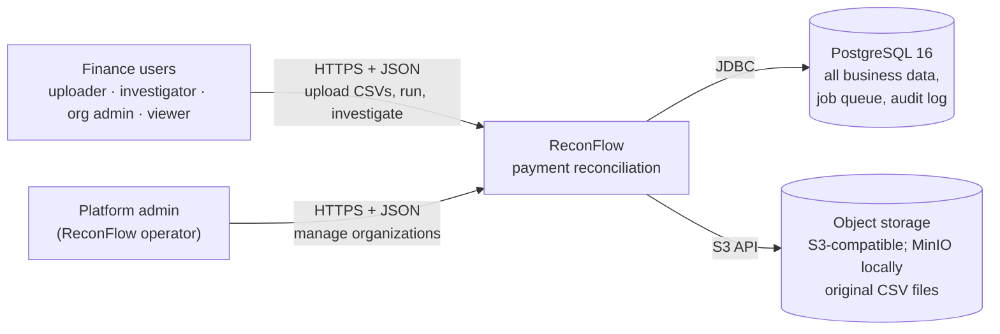
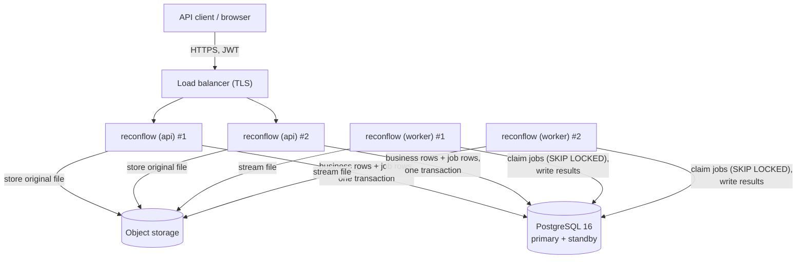
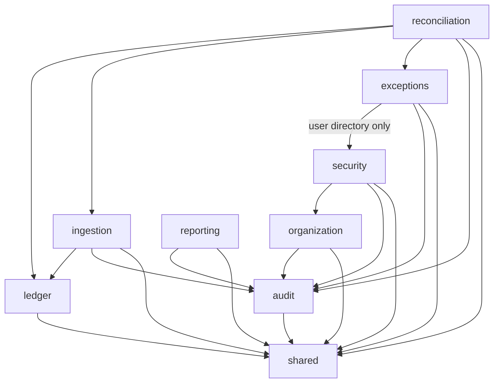
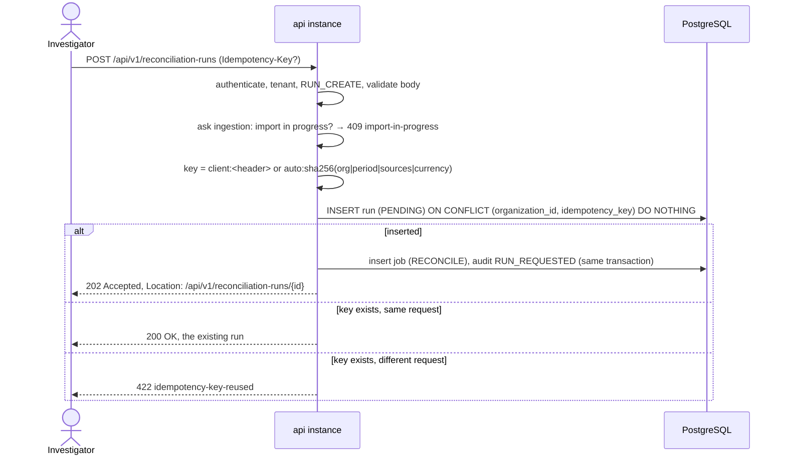

# Architecture

**Status:** Accepted for v1 (revised to match the code in M11.10) · **Task:** TASKS.md M1.9 · **Date:** 2026-11-16

How ReconFlow is put together: who talks to it, what runs where, which module owns what, which module may call which, how the main requests flow, and how background work runs. The capacity reasoning behind these choices is in [scalability.md](scalability.md); the decisions are recorded as ADRs in [adr/](adr/).

---

## 1. Context



ReconFlow has no other external dependencies in v1: no message broker, no cache, no email service. Files arrive by manual upload through the API (v2 adds SFTP and gateway pulls).

---

## 2. Containers

One codebase, one jar, run as two kinds of process ([ADR 0002](adr/0002-modular-monolith.md)):



| Container | Profile | Does | Doesn't |
|---|---|---|---|
| API instance | `api` | Authenticates, authorizes, validates, answers reads, accepts uploads and run requests, writes job rows | Run imports or reconciliation |
| Worker instance | `worker` | Claims jobs from the `job` table and runs them: imports, reconciliation runs, large exports; runs the lease sweeper and partition maintenance | Serve HTTP traffic (only actuator health) |
| PostgreSQL 16 | — | All business data, the job queue, the audit log | — |
| Object storage | — | Original uploaded files, large exports | Hold anything the database needs to query |

Why two process kinds: a 100k-row import takes 10–30 seconds of CPU and I/O. Running it on API threads would make browsing slow during the 09:00 upload burst. Separate worker processes isolate that load, while one codebase keeps one set of transaction boundaries and one deployment pipeline. API instances are stateless (JWT, no sessions), so any instance can serve any request.

---

## 3. Modules and ownership

The root package is `com.reconflow.paymentreconflow`. Each module is a top-level package. A module's **public API** is the types in its top-level package; everything in sub-packages (`internal`, `domain`, …) is private to the module. Spring Modulith tests enforce this (M2.9).

**A table is written only by its owning module.** Other modules read it through the owner's public API. There are two deliberate exceptions, both read-only SQL: `reporting` (aggregate queries over everything) and the matching engine's set-based SQL in `reconciliation` (§4).

| Module (package) | Responsibility | Owns tables |
|---|---|---|
| `organization` | Organizations: create, suspend, list (platform admins) | `organization` |
| `security` | Users, membership, login, tokens, the tenant-context filter, roles → permissions (layout: [authentication.plan §6](../plans/authentication.plan)) | `app_user`, `membership`, `refresh_token` |
| `ingestion` | Upload, file storage, parsing, validation, normalization, import status | `import_batch`, `import_row_error` |
| `ledger` | The normalized transaction store, its writer and its search API | `transaction_record` (and its partitions) |
| `reconciliation` | Runs, the matching engine, matches | `reconciliation_run`, `reconciliation_match` |
| `exceptions` | Cases, the workflow state machine, notes, history | `exception_case`, `exception_case_record`, `exception_case_run` (added in M6), `exception_note`, `exception_status_history` |
| `reporting` | Read-only aggregate reports and CSV export (large exports through an `EXPORT` job) | none |
| `audit` | `AuditService`, the audit timeline API | `audit_event` |
| `shared` | Cross-cutting building blocks: UUIDv7 IDs, money helpers, errors / `ProblemDetail`, pagination, request ID, the job queue (`shared.jobs`), object storage (`shared.storage`, moved from `ingestion` in M8 so exports can use it), and the **interfaces** `TenantContext`, `CurrentUser`, `TenantScope`, `Permission` (implemented in `security`) | `job` |

---

## 4. Allowed dependencies

An arrow means "may call the public API of".

```
ingestion      ──▶ ledger, audit, shared
reconciliation ──▶ ledger, ingestion, exceptions, audit, shared
exceptions     ──▶ audit, shared, security (user-directory API only)
reporting      ──▶ audit, shared                (reads via SQL, no module APIs; audits exports)
organization   ──▶ audit, shared
security       ──▶ organization, audit, shared
audit          ──▶ shared
ledger         ──▶ shared
shared         ──▶ (nothing)
```



The rules, and why:

- **No cycles.** `reconciliation → exceptions` is allowed; `exceptions → reconciliation` isn't. When a case needs run information, the reconciliation module passes it in (the run ID in each `Discrepancy`). A cycle would mean neither module can be understood, tested or extracted without the other.
- **Identity and tenant come through `shared`, never by importing `security`.** `TenantContext` and `CurrentUser` are interfaces in `shared`, implemented in `security`. That breaks the cycle that would otherwise appear: `audit` needs the current user, and `security` needs to audit logins (`security → audit → security`).
- **`security` exposes almost nothing.** The only API other modules may call is the user directory: "is this user a member of this org with this permission?" and display names (used by `exceptions` to validate assignees). Login, tokens and the filter are internal.
- **The engine creates exceptions through `exceptions`' public API** (`DiscrepancyRecorder`, designed in phase-M6), inside the same transaction as the chunk's matches, so a chunk commits its matches, its cases and its checkpoint atomically. The alternative, publishing "discrepancy found" events that the exceptions module consumes, decouples the modules but splits one atomic step into two, which then needs an outbox and idempotent consumers. Not worth it inside one process.
- **`reconciliation → ingestion`** exists for one call: "does this organization have an import in progress?", checked before starting a run (phase-M6 §M6.7), because a run over a half-imported gateway file would report every payment missing.
- **The matching engine reads `transaction_record` with SQL.** Set-based matching is a join inside PostgreSQL ([ADR 0012](adr/0012-set-based-matching-in-sql.md)); it can't go through a Java API without loading millions of rows into memory. The engine's SQL reads `ledger`'s table (and the batch status, for rule P3) read-only and never writes it. This is the one place the "read through the owner's API" rule is traded for performance, and it's confined to the SQL files of one strategy class.
- **Transaction search joins `import_batch` the same way.** `GET /transactions` lives in `ledger` and must show only records of accepted batches (rule P3); it reads `ingestion`'s `import_batch.status` in its SQL, read-only, rather than calling `ingestion` (which `ledger` may not depend on) once per page. `SourceType` lives in `ledger`'s public API for the same direction-of-dependency reason.
- **The exception detail view joins `transaction_record` the same way.** `GET /exceptions/{id}` shows every linked record side by side; `exceptions` may not depend on `ledger` (that would invert `reconciliation → exceptions`), and one call per record would be N+1, so one read-only join on `(id, transaction_date)`, confined to `ExceptionQueries`, reads them (M7.7).
- **The audit timeline carries actor ids, not names.** `audit` depends on `shared` only and `security` depends on `audit`, so `GET /audit-events` can't ask the user directory for display names without a cycle; a client resolves names separately (M7.13).
- **`reporting` depends on `shared` and `audit` only: read-model SQL (M8).** Reports are read-only SQL over the other modules' tables through `JdbcClient`, returning final aggregates. Going through each module's API would mean N+1 calls and in-memory joins for every report (option A in phase-M8 §2.4); an event-fed read model (option C) would decouple the schemas but costs machinery and eventual consistency. The coupling this leaves is to other modules' **schemas**, not their Java types (so `ModularityTest` stays green), and it is contained three ways: `reporting` never writes another module's table; all of its SQL lives in one `*Queries` class per report (plus the exporter's one statement); and every statement runs against the migrated schema in CI (`ReportQueryPlanIT` EXPLAINs each one, the report ITs check its results), so a renamed column fails the build. `audit` was added in M8.4 because an export is financial data leaving the system. If modules ever moved to separate databases, this becomes an event-fed read model.

These rules become `ApplicationModules.verify()` tests in M2.9, plus an ArchUnit rule that nothing outside `security` imports `security.auth` or `security.token`.

---

## 5. Request flows

### 5.1 Upload a file

```mermaid
sequenceDiagram
    actor U as Uploader
    participant API as api instance
    participant S3 as Object storage
    participant DB as PostgreSQL
    U->>API: POST /api/v1/imports (multipart: file, sourceType)
    API->>API: authenticate, tenant, IMPORT_CREATE, size / type checks
    API->>API: SHA-256 of the bytes; parse the header only
    alt duplicate hash, missing columns, empty file…
        API-->>U: 4xx ProblemDetail (nothing stored)
    end
    API->>S3: put original file (key = {orgId}/imports/{batchId}/original.csv)
    API->>DB: BEGIN; insert import_batch (RECEIVED), job (IMPORT), audit IMPORT_RECEIVED; COMMIT
    API-->>U: 202 Accepted, Location: /api/v1/imports/{id}
```

**Ordering matters:** the file is stored **before** the database transaction. If storage succeeds and the transaction fails, there's an orphan file: harmless, and a cleanup job can remove it. The reverse order would leave a committed batch pointing at a file that doesn't exist: harmful, because the worker would fail on it forever. If a concurrent upload of the same file wins the unique constraint, this request deletes its just-stored object and returns `409 duplicate-file` with the winner's ID.

Because the batch row and its job row commit in one transaction, there's no moment where a batch exists without a job (stuck forever) or a job exists without a batch.

### 5.2 Process an import (worker)

```mermaid
sequenceDiagram
    participant W as worker instance
    participant DB as PostgreSQL
    participant S3 as Object storage
    W->>DB: claim job (FOR UPDATE SKIP LOCKED, per-org cap 2), set lease
    W->>DB: lock batch; RECEIVED → PROCESSING (or resume if PROCESSING)
    W->>S3: download file to a temp file
    loop every 5,000 rows
        W->>W: parse, validate, normalize (streaming)
        W->>DB: BEGIN; fence check; insert records + row errors; update counters and last_committed_row; COMMIT
        W->>DB: heartbeat (extend lease)
    end
    W->>DB: BEGIN; flag within-file duplicates (D1); COMPLETED / COMPLETED_WITH_ERRORS; audit; job DONE; COMMIT
```

A crash between chunks loses at most one uncommitted chunk. The sweeper re-queues the job when its lease expires, and the next worker skips rows up to `last_committed_row`.

### 5.3 Request a reconciliation run



The worker then processes the period one **anchor day** at a time: each reference group belongs to the day of its earliest record, and each day's matches, cases and checkpoint (`last_completed_date`) commit in one transaction ([ADR 0012](adr/0012-set-based-matching-in-sql.md)). The last transaction computes the summary and marks the run `COMPLETED`.

### 5.4 Resolve an exception

```mermaid
sequenceDiagram
    actor I as Investigator
    participant API as api instance
    participant DB as PostgreSQL
    I->>API: POST /api/v1/exceptions/{id}/resolve, If-Match: "4", {resolutionCode, note}
    API->>API: authenticate, tenant, EXCEPTION_RESOLVE
    alt no If-Match
        API-->>I: 428 precondition-required
    end
    API->>DB: BEGIN; load case WHERE id AND organization_id (404 if not ours)
    API->>API: version == 4? (else 409 stale-version) · transition allowed? (else 409 invalid-transition) · code and note valid? (else 400)
    API->>DB: update case (RESOLVED, resolution fields, version 5 WHERE version 4); insert status history; audit EXCEPTION_RESOLVED; COMMIT
    API-->>I: 200 OK, ETag: "5", updated case
```

The explicit version compare catches the slow race (the client read version 4 long ago); the `WHERE version = 4` in the update catches the fast race (two requests in flight at once). Either way, exactly one resolve wins and the other gets `409`.

---

## 6. Background processing

Summary of [scalability.md §4](scalability.md#4-background-processing); the decision is [ADR 0004](adr/0004-postgresql-job-queue.md).

- **Imports and runs are asynchronous from v1** ([ADR 0003](adr/0003-asynchronous-imports-and-runs.md)). The API returns `202 Accepted` with a `Location` to poll. The job table is a v1 requirement, built in M5 (moved forward from M9.2) and hardened in M9.
- **The queue is the `job` table** in PostgreSQL, owned by `shared.jobs`. Each module plugs in a `JobHandler` for its job type (`IMPORT`, `RECONCILE`, `EXPORT`). The worker loop is switched on by `reconflow.jobs.worker.enabled`, which the `worker` profile sets.
- **Claiming:** `SELECT … FOR UPDATE SKIP LOCKED`, oldest first, skipping organizations that already have 2 running jobs (noisy-neighbour fairness). **The cap is soft (decided in M9.2):** `SKIP LOCKED` locks the candidate row, not the "count of running jobs" predicate, so claimers racing at the same instant can each see one running job and each claim; the overshoot is bounded by the number of simultaneous claimers. That is enough for what the cap is for (a small tenant is never starved, `JobQueueHardeningIT`). A hard cap would serialize claims per organization with `pg_advisory_xact_lock(hashtext(organization_id::text))` and a re-count in a second statement, adding a round trip to every claim for no measured benefit.
- **Retention:** `JobRetention` deletes `DONE` jobs after 30 days and `FAILED` ones after 180 (their `last_error` is what an operator diagnoses), in bounded batches, daily on workers. The business outcome lives in the batch, run or export row and in `audit_event`.
- **Leases and heartbeats:** a claimed job gets `lease_until = now() + 2 min`, extended every 30 s. A sweeper re-queues `RUNNING` jobs whose lease expired, so a crashed worker's job is picked up by another.
- **Retries:** transient failures are retried with exponential backoff (`run_after = now() + 2^attempts × 10 s` ± 20 % jitter, capped at 1 h); permanent failures (bad data, invariant violations) are not. After `max_attempts` the job and its business entity are `FAILED`. A handler that can't start *yet* (a run while an import of its organization is processing) throws `JobDeferredException`: the job goes back to the queue after a delay without spending an attempt.
- **Two retry layers (M9.3), deliberately different.** In-process, `TransientRetry` (Spring Framework 7's `RetryTemplate`) re-runs one chunk's whole transaction after a transient database failure (deadlock, serialization failure, lock or statement timeout, dropped connection): 3 retries at 100/200/400 ms ± 50 ms. It refuses to run inside a transaction, because an aborted PostgreSQL transaction can't be retried, only rolled back. If that doesn't fix it, the job queue's backoff (minutes) is the second layer. One classifier (`TransientFailures`) serves both: SQLState first (Spring translates connection loss to a *non*-transient type), then Spring's hierarchy; optimistic-lock conflicts, constraint violations and lost leases are never retried. HTTP requests never retry, so a user's `409` always reaches the user. Retrying a commit whose outcome is unknown is safe because each chunk's checkpoint is a compare-and-set that recognises "already committed".
- **Recovery (M9.1):** the job row says whether work is alive, the batch or run says how far it got; neither has a lease of its own. An expired lease with attempts left re-queues the job and leaves the batch `PROCESSING` (users never see `FAILED`, then `COMPLETED`); with none left, the sweeper fails job and batch (or run) in one transaction with `retries-exhausted` and an audit event. A starting worker sweeps once at `ApplicationReadyEvent`, reclaiming only **expired** leases, never "jobs locked by my hostname". The heartbeat thread flags a job whose lease it finds gone, and handlers check the flag between rows and days (`JobContext.ensureLeaseHeld`), so a paused worker stops instead of building a chunk its fence would refuse. Every 5 minutes a consistency check visits each organization (bound, so RLS applies) for batches and runs in flight with no `QUEUED`/`RUNNING` job, logs them at `ERROR`, counts them (`reconflow.jobs.orphaned`) and fails them as `orphaned`; never re-enqueued automatically, since an orphan is a bug.
- **Proved by failure injection (M9.4).** `shared.fault.FaultInjector` names points on the processing path (`import.before-chunk-commit`, `import.after-chunk-commit`, `import.after-last-chunk`, `exceptions.after-case-insert`, `reconcile.after-day-commit`, `reconcile.before-summary`, plus `storage.put`/`storage.download`); production wires a no-op lambda. `FailureInjectionIT` crashes the full upload → import → run pipeline at each point on its first, second and last hit, recovers the way production does (lease expiry, sweep, resume) and requires a snapshot (records, matches, cases with their links and history, batches, row errors, run and day totals, audit counts; no ids or timestamps) identical to a run that never crashed. The job runner's transient-retry path and storage outages are tested the same way. An upload during a storage outage is `503 storage-unavailable` with `Retry-After`, and creates nothing.
- **At-least-once execution, exactly-once effect:** a job may run more than once (a worker paused past its lease), so every write it makes is idempotent (unique constraints, `ON CONFLICT DO NOTHING`, checkpoints) and fenced (a chunk checks that it still owns the work before committing).
- **Enqueue in the same transaction as the business row**, so there is no dual-write problem: either both the run and its job exist, or neither does.
- **Kafka is deferred.** It solves a throughput problem (thousands of messages per second, many consumers) that ReconFlow doesn't have, and introducing it would bring back the dual-write problem unless paired with an outbox. M9.12 measures whether that ever changes.

---

## 7. Cross-cutting concerns

| Concern | Design |
|---|---|
| Authentication | In-house JWT (RS256, 15-minute access token, rotating refresh token in an `HttpOnly` cookie), validated by Spring's OAuth2 resource server. Full design: [authentication.plan](../plans/authentication.plan). Replaced by Keycloak in M10.1 without touching other modules |
| Authorization | Roles map to permissions in one class (`RolePermissions`); code checks permissions (`@PreAuthorize("hasAuthority('EXCEPTION_RESOLVE')")`), never role names. Permissions are looked up per request, not stored in the token, so a role change applies on the next request |
| Tenancy | `X-Organization-Id` selects the organization; `TenantContextFilter` verifies membership and fills the request-scoped `TenantContext`. Every repository method takes `organizationId`. PostgreSQL row-level security is a second layer: each transaction runs `set_config('app.org_id', …, true)` (the function form of `SET LOCAL`), so a query that forgets its `WHERE organization_id` returns nothing instead of another tenant's rows. Another tenant's IDs return `404` ([ADR 0008](adr/0008-tenant-isolation.md)) |
| Audit | `AuditService.record(...)` uses `Propagation.MANDATORY`, so it can only run inside the caller's transaction: if the business change rolls back, so does its audit row. Database triggers block `UPDATE`, `DELETE` and `TRUNCATE` on `audit_event` |
| Errors | One `@RestControllerAdvice` renders every error as an RFC 9457 `ProblemDetail` with `type`, `code` and `requestId`; no stack traces or SQL in responses ([api-design.md §3](api-design.md#3-error-model)) |
| Observability | A filter assigns or accepts `X-Request-Id`, puts it in the MDC and echoes it in the response; `prod` logs are JSON. Micrometer metrics (M9.9), all with small fixed tag sets (never an organization, batch, run or user id; per-tenant questions go to logs and reports): `reconflow.import.rows{source_type,outcome}`, `reconflow.import.duration{source_type,outcome}`, `reconflow.reconciliation.duration{outcome}`, `reconflow.reconciliation.results{result}`, `reconflow.exceptions.open{type}`, `reconflow.jobs.queued{type}`, `reconflow.jobs.queue.wait{type}`, `reconflow.jobs.completed{type,outcome}`, `reconflow.jobs.lease.lost{type}`, `reconflow.jobs.orphaned{type}`, `reconflow.db.retries{operation}`, `reconflow.partitions.default.rows`, plus Boot's HTTP (by URI template), JVM, Hikari and Tomcat meters. Timers publish histogram buckets with the SLO boundaries as exact buckets. Counters move after commit only. Gauges built from database counts are refreshed on a schedule on worker nodes (the open-cases count visits each organization with it bound, because of RLS), never queried per scrape. Exported to Prometheus (M9.10) |
| Money | `BigDecimal` / `NUMERIC(19,4)`, strings in JSON ([reconciliation-rules.md §8](reconciliation-rules.md#8-money-handling)) |
| IDs | UUIDv7 generated in the application ([ADR 0010](adr/0010-uuidv7-primary-keys.md)); the M6 migration adds a matching SQL function for set-based inserts |

---

## 8. Deployment profiles

One jar; behaviour is selected by Spring profiles. A process runs one **role** profile and one **environment** profile.

| Profile | Kind | Effect |
|---|---|---|
| `api` | Role | HTTP controllers and filters active; job worker loop off |
| `worker` | Role | Sets `reconflow.jobs.worker.enabled=true`: the claim loop, sweeper and partition-maintenance job run. Controllers aren't needed beyond actuator health |
| `local` | Environment | Docker Compose PostgreSQL and MinIO, seed data (two organizations, a user per role), readable logs, `Secure` cookie flag off for Safari. Usually run as `local,api,worker` in one process |
| `test` | Environment | Testcontainers PostgreSQL via `@ServiceConnection`; each test creates a fresh organization instead of truncating tables (audit tables can't be truncated) |
| `prod` | Environment | JSON logs, secrets only from environment variables, `ddl-auto=validate`, Swagger UI off |

**Ports (M9.10).** `server.port` (8080) serves the API and is the only port behind the load balancer. In `local` and `prod`, actuator moves to `management.server.port` (8081, `MANAGEMENT_PORT`): the liveness and readiness probes and `/actuator/prometheus`, which the security chain permits only on that port and refuses on 8080 even to a logged-in user. Prometheus and Grafana run under compose's `observability` profile (`ops/prometheus`, `ops/grafana`: a provisioned dashboard and alert rules, including the default-partition alert and its runbook in `docs/runbooks/`).

Locally, a single `local,api,worker` process does everything. In production, the same image is deployed twice: two instances with `prod,api` behind the load balancer, and two with `prod,worker`.
