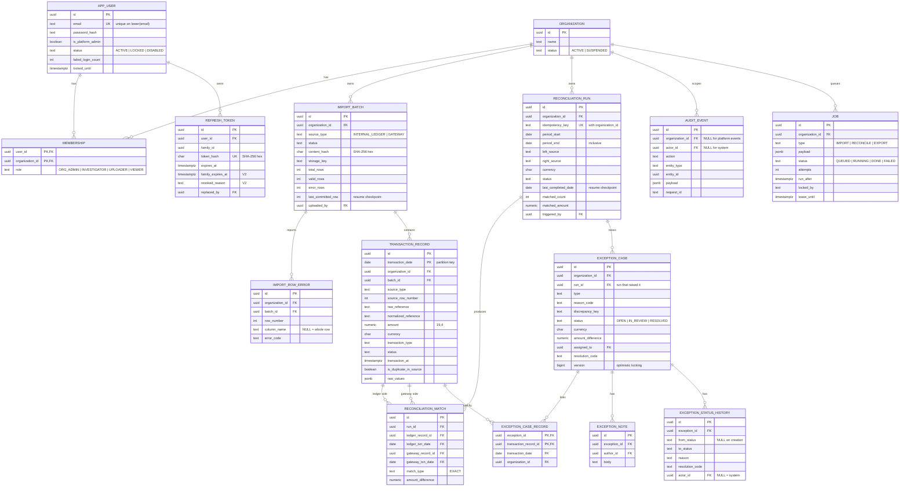

# Database design

**Status:** Accepted for v1 · **Task:** TASKS.md M1.10 · **Date:** 2026-11-16

This documents and justifies the schema that already exists in `src/main/resources/db/migration/V1__initial_schema.sql`, `V2__auth_hardening.sql` and `V3__refresh_token_constraints.sql`, plus the row-level security policies of `V4__row_level_security.sql` (M3.5, §tenancy below). The schema was written before this document, so most decisions were already made in SQL; this is the paperwork that explains them, plus the changes later phases are planned to make.

PostgreSQL 16. Flyway owns the schema; Hibernate runs with `ddl-auto=validate` and never changes it.

---

## 1. Conventions

| Convention | Rule | Why |
|---|---|---|
| Primary keys | `UUID`, UUIDv7, generated by the application. No `DEFAULT` on id columns | PostgreSQL 16 has no built-in `uuidv7()` (it arrives in 18). Time-ordered UUIDs are safe to expose and insert-friendly for B-trees ([ADR 0010](adr/0010-uuidv7-primary-keys.md)) |
| Tenancy column | Every tenant-owned table has `organization_id`, **including child tables** (`import_row_error`, `exception_case_record`, `exception_note`, …) | Row-level security (M3.5) needs the column on the row it filters, and tenant-leading indexes need it to lead |
| Money | `NUMERIC(19,4)`, never `float` / `double precision` | Exact decimal arithmetic ([reconciliation-rules.md §8](reconciliation-rules.md#8-money-handling)) |
| Currency | `CHAR(3)` with `CHECK (currency ~ '^[A-Z]{3}$')` | ISO-4217 shape is enforced in the database; validity against the real code list is checked by the importer |
| Statuses and types | `TEXT` + `CHECK (… IN (…))`, not PostgreSQL `ENUM` types | Adding a value is a one-line constraint change in a new migration instead of an `ALTER TYPE`, which can't run inside a transaction block in older versions and is awkward to roll back |
| Timestamps | `TIMESTAMPTZ`. `created_at` defaults to `now()`. `updated_at` is maintained by the application (`@UpdateTimestamp`), not by triggers | One clock (UTC instants). JDBC updates that bypass Hibernate must set `updated_at = now()` themselves |
| Foreign-key indexes | PostgreSQL doesn't index FK columns automatically; every FK that is queried or joined on has an explicit index | Without them, joins and `ON DELETE` checks scan whole tables |
| Names | Singular `snake_case` tables (`exception_case`), `_idx` for indexes, `_uk` for unique indexes | Predictable names make constraint-violation handling by name possible (`import_batch_content_uk`) |

---

## 2. ERD



`exception_case_run` (every run that observed a case) is added by the M6 migration (`V5`) and isn't in V1, so it's not drawn here.

---

## 3. Tables

### 3.1 Users and tenancy

**`organization`** (owner: `organization`). A customer business, the tenant boundary. `status` is `ACTIVE` or `SUSPENDED`; a suspended organization's members get `404` on every org-scoped route.

**`app_user`** (owner: `security`). A **global** user: one person can belong to several organizations, each with its own role, so the user isn't owned by an organization and has no `organization_id`. Email is unique case-insensitively through the expression index `app_user_email_uk ON (lower(email))` (no `citext` extension needed; look users up with `WHERE lower(email) = lower(:email)` so the index is used). `password_hash` is in `DelegatingPasswordEncoder` format (`{bcrypt}$2a$…`) so the algorithm can be upgraded per user. `status = LOCKED` is an administrative block; `locked_until` is the automatic brute-force lock that expires by itself (authentication.plan §4.5).

**`membership`** (owner: `security`). `PRIMARY KEY (user_id, organization_id)`: one role per user per organization. `role` CHECK: `ORG_ADMIN`, `INVESTIGATOR`, `UPLOADER`, `VIEWER`. `created_by` is NULL only for seeded and bootstrap users. Index `membership_org_idx (organization_id)` serves "list the members of an org".

**`refresh_token`** (owner: `security`). Only the SHA-256 hash of each refresh token is stored (`token_hash CHAR(64) UNIQUE`). `family_id` groups every token descended from one login, so a reused token can revoke its whole family. V2 added `family_expires_at` (the 30-day cap, copied on each rotation) and `revoked_reason` (CHECK `ROTATED`, `LOGOUT`, `REUSE_DETECTED`, `PASSWORD_CHANGED`, `ADMIN_REVOKED`, `USER_DISABLED`; NULL while the token is live); V3 made the revocation fields consistent (§4). Indexes: `refresh_token_family_idx`, `refresh_token_user_idx`, and V3's `refresh_token_family_expiry_idx (family_expires_at)` for the sweeper.

### 3.2 Cross-cutting

**`audit_event`** (owner: `audit`). Append-only. `organization_id` is NULL for platform events (a failed login for an unknown email); `actor_id` is NULL for system actions (workers, sweeper). `payload JSONB` holds action-specific details, kept small and free of raw financial data. Indexes: `audit_event_entity_idx (organization_id, entity_type, entity_id, created_at)` for an entity's timeline, `audit_event_actor_idx (organization_id, actor_id, created_at)` for "what did this user do".

**`job`** (owner: `shared.jobs`). The background job queue ([ADR 0004](adr/0004-postgresql-job-queue.md)). `type` CHECK `IMPORT`, `RECONCILE`, `EXPORT`; `status` CHECK `QUEUED`, `RUNNING`, `DONE`, `FAILED`; `attempts ≥ 0`, `max_attempts > 0` (default 5). Three partial indexes, each covering only the rows its query touches:

| Index | Serves |
|---|---|
| `job_claim_idx (run_after, created_at) WHERE status = 'QUEUED'` | The claim query: oldest runnable job first |
| `job_running_org_idx (organization_id) WHERE status = 'RUNNING'` | The per-organization fairness count (≤ 2 running) |
| `job_lease_idx (lease_until) WHERE status = 'RUNNING'` | The sweeper's search for expired leases |

### 3.3 Ingestion

**`import_batch`** (owner: `ingestion`). One uploaded file. `content_hash` is the SHA-256 of the file bytes, `storage_key` the object-storage key of the original. `total_rows`, `valid_rows`, `error_rows` are updated in the same transaction as each chunk, so they're exact after any crash; `last_committed_row` is the resume checkpoint. Indexes: `import_batch_content_uk` (§4), `import_batch_list_idx (organization_id, created_at DESC)` for the newest-first list.

**`import_row_error`** (owner: `ingestion`). One row per (row, column, error code). `row_number` is the 1-based data row, header excluded; `column_name` is NULL for whole-row errors such as `MALFORMED_ROW`. `raw_row` keeps the row text so a user can see what was wrong without the original file. Error codes are listed in [requirements.md §7.5](requirements.md#75-row-errors); there's no CHECK on `error_code`, so adding a code is a code change.

**`transaction_record`** (owner: `ledger`). Every valid row from every source, normalized, partitioned by month on `transaction_date` (§5). Key columns: `raw_reference` and `raw_values` (exactly what the file said), `normalized_reference` (rules N1–N4), `amount NUMERIC(19,4)`, `currency CHAR(3)`, `transaction_type` CHECK `PAYMENT | REFUND | CHARGEBACK | FEE` (default `PAYMENT`), `status` CHECK `SUCCESS | PENDING | FAILED | REVERSED`, `transaction_date` (UTC date, rule N7), `transaction_at` (NULL for date-only ledgers), `is_duplicate_in_source` (rule D1), `source_row_number` (the row in its file). `PRIMARY KEY (id, transaction_date)` because the partition key must be in every unique constraint. Indexes, created on the parent and so on every partition:

| Index | Serves |
|---|---|
| `transaction_record_match_idx (organization_id, source_type, transaction_date, normalized_reference)` | Date-range filters and per-day scans |
| `transaction_record_batch_idx (organization_id, batch_id)` | Import detail, search by batch, the within-file duplicate update, retry deletes |
| `transaction_record_reference_idx (organization_id, normalized_reference, transaction_type, transaction_date)` | *Added by the M6 migration.* The engine looks a group up by reference across the whole period; the match index leads with the date, so it can't |

**Query plans (M5.6).** `TransactionQueryPlanIT` loads 120,000 rows for one organization over September and October 2026, runs `ANALYZE`, and checks the plans (PostgreSQL 16):

```text
-- GET /transactions shape: org + source + one month, join to the batch for rule P3, first page
Limit (rows=51)
  ->  Incremental Sort  (Sort Key: t.transaction_date, t.id; Presorted Key: t.transaction_date)
        ->  Nested Loop
              ->  Index Scan using transaction_record_2026_10_organization_id_source_type_tran_idx on transaction_record_2026_10 t
                    Index Cond: ((organization_id = …) AND (source_type = 'GATEWAY') AND (transaction_date >= '2026-10-01') AND (transaction_date <= '2026-10-31'))
              ->  Memoize (Cache Key: t.batch_id; Hits: 984  Misses: 1)
                    ->  Index Scan using import_batch_pkey on import_batch b  (Filter: status = ANY ('{COMPLETED,COMPLETED_WITH_ERRORS}'))
Execution Time: 0.6 ms

-- the engine's per-day lookup (M6)
Index Scan using transaction_record_2026_10_organization_id_source_type_tran_idx on transaction_record_2026_10 t
  Index Cond: ((organization_id = …) AND (source_type = 'GATEWAY') AND (transaction_date = '2026-10-15') AND (normalized_reference = 'PAY-1000'))
Execution Time: 0.01 ms
```

Only the October partition is touched (pruning), the match index serves both shapes, and the batch join is one memoized primary-key lookup per batch. Not served well: a `reference` search across a wide date range **without** `sourceType`, which can only use the index's `organization_id` prefix and then filters. No index is added for it speculatively; M9.7 measures it on realistic data, and M6's `transaction_record_reference_idx` (leading with `organization_id, normalized_reference`) will serve it anyway.

### 3.4 Reconciliation

**`reconciliation_run`** (owner: `reconciliation`). One execution of the rules. `idempotency_key` with `UNIQUE (organization_id, idempotency_key)` (§4); `period_start`, `period_end` (inclusive) with `CHECK (period_end >= period_start)`; `left_source`, `right_source` (defaults ledger and gateway) with `CHECK (left_source <> right_source)`; one `currency` ([ADR 0009](adr/0009-run-pinned-to-one-currency.md)); `status` CHECK `PENDING | RUNNING | COMPLETED | FAILED`; `last_completed_date` is the resume checkpoint, since runs commit one day at a time. Summary columns are computed once at completion: `matched_count/amount`, `mismatch_count`, `mismatch_net_difference`, `unmatched_left_count/amount`, `unmatched_right_count/amount`, `duplicate_count`. Counts are **cases**, not records. The M6 migration (`V5__reconciliation_engine.sql`) adds `currency_mismatch_count`, `excluded_count` (records failing rule P4 or P5, so the invariant can be checked from the run alone) and `request_fingerprint` (to detect an `Idempotency-Key` reused with a different body). Indexes: `reconciliation_run_list_idx (organization_id, created_at DESC)`; V5's partial unique `reconciliation_run_active_scope_uk (organization_id, currency, left_source, right_source, period_start, period_end) WHERE status IN ('PENDING', 'RUNNING')`, at most one active run per scope. The checkpoint `last_completed_date` and the summary are written by SQL in the chunk and completing transactions (never through a stale entity), each setting `updated_at = now()` itself.

**`reconciliation_run_day`** (owner: `reconciliation`, `V7__reporting_run_days.sql`, M8.1). One row per run and anchor day, with the run summary's columns for that day (except `excluded_count`, which has no day), written by the engine in the day's chunk transaction next to its matches, cases and checkpoint; `PRIMARY KEY (run_id, day)` with a plain insert, so a second row for a day is a bug that fails the chunk. The date-range report picks, per day, the most recently completed run (`DISTINCT ON (day) … ORDER BY day, completed_at DESC`) and sums only those rows, so overlapping runs never count a day twice; `RunDayTotalsIT` proves a completed run's day rows add up to its summary. Index `reconciliation_run_day_lookup_idx (organization_id, currency, day)`; RLS like every tenant-owned table.

**`reconciliation_match`** (owner: `reconciliation`). One row per matched pair. Foreign keys to a partitioned table must reference its **full** primary key, so each record id travels with its date: `(ledger_record_id, ledger_txn_date)` and `(gateway_record_id, gateway_txn_date)` both reference `transaction_record (id, transaction_date)`. That also lets every join prune to one partition. `match_type` CHECK `EXACT` only in v1; `amount_difference` is always 0 for `EXACT` and exists for fee-aware matching in v2. Indexes on both record ids, for "is this record matched?".

### 3.5 Exceptions

**`exception_case`** (owner: `exceptions`). A discrepancy needing a human. `type` CHECK is the five types in [reconciliation-rules.md §5](reconciliation-rules.md#5-exception-types-and-reason-codes); `status` CHECK `OPEN | IN_REVIEW | RESOLVED`; `discrepancy_key` is the problem's deterministic identity (rules §6; V1's column comment shows the older short form `AMOUNT_MISMATCH:PAY-103`, the rules doc's longer form is current); `run_id` is the run that **raised** it; `version BIGINT` is the optimistic-locking counter. `reason_code` and `resolution_code` are validated by the application, with no CHECK. The M6 migration adds `amount NUMERIC(19,4) NOT NULL` (the amount at stake). Indexes:

| Index | Serves |
|---|---|
| `exception_case_active_uk (organization_id, discrepancy_key) WHERE status <> 'RESOLVED'` | One active case per discrepancy (§4) |
| `exception_case_list_idx (organization_id, status, created_at DESC)` | The work queue, the busiest query in the product |
| `exception_case_assignee_idx (organization_id, assigned_to, status) WHERE assigned_to IS NOT NULL` | "My exceptions" |
| `exception_case_run_idx (run_id)` | Cases raised by a run |

Plans checked in M7.6 (`ExceptionListQueryPlanIT`: 30,000 cases per organization, four organizations, about 70% resolved, ANALYZEd): the default queue (`status IN (OPEN, IN_REVIEW)`, newest first) is a bitmap scan of `exception_case_list_idx` plus a top-N sort of the organization's open cases (two status values stop the index from also giving the order; ~1.6 ms for 9,000 open cases); `assignedTo=<id>|me` uses `exception_case_assignee_idx`; `assignedTo=unassigned` uses `exception_case_list_idx` with a filter on `assigned_to`, because the open queue is a small, mostly unassigned slice, so **no** partial `WHERE assigned_to IS NULL` index was added; `runId` drives a nested loop from `exception_case_run_pkey (run_id, exception_id)`. If one organization's open queue grows to hundreds of thousands, the fixes are keyset pagination and one index scan per status merged in order.

**`exception_case_record`** (owner: `exceptions`). Links a case to every record involved. A link table rather than two FK columns, because a duplicate case can involve three or more records. `PRIMARY KEY (exception_id, transaction_record_id)`; FK `(transaction_record_id, transaction_date)` to the partitioned table.

**`exception_case_run`** (owner: `exceptions`, added in M6). Every run that observed a case, whether it created it or found it already active, with a `created` flag. It answers "which cases did this run see?", which `exception_case.run_id` can't once a second run re-observes a case. `PRIMARY KEY (run_id, exception_id)`, index `exception_case_run_exception_idx (exception_id)`, RLS like every tenant-owned table (in V5). The run summary's exception counts are computed from it. V7 adds `day` (nullable for older links): the anchor day on which the run observed the case, so the date-range report attributes each case to the same (run, day) as the day totals; V8 adds `exception_case_run_day_idx (run_id, day)` for that lookup, found by M8.5's plan check (docs/benchmarks.md).

**`uuid_generate_v7()`** (V5). A SQL function producing UUIDv7 with the same layout as the Java generator (millisecond timestamp in the first 48 bits, version nibble 7), so set-based `INSERT … SELECT` can generate ids inside the database; `ReconciliationRunRepositoryIT` checks the version and timestamp.

**`exception_note`** (owner: `exceptions`). Investigation notes, append-only: `V6__exception_history_append_only.sql` adds row triggers that reject `UPDATE`/`DELETE` and a statement trigger that rejects `TRUNCATE` (function `block_history_changes()`, message `<table> is append-only: <op> is not allowed`). `CHECK (length(btrim(body)) > 0)` rejects blank notes in the database too. Notes are retained with the case; there is no delete path (an accepted v1 limit for data-deletion requests: a real system would pseudonymise authors or crypto-shred).

**`exception_status_history`** (owner: `exceptions`). One row per status change: `from_status` (NULL on creation), `to_status` (CHECK on the three statuses), `reason`, `resolution_code` and `resolution_note` (copied so a reopen doesn't lose them), `actor_id` (NULL for system transitions). `audit_event` records the same change for compliance; this table answers "what happened to this case?" with a simple query instead of parsing audit payloads. Append-only with the same V6 triggers as `exception_note`.

---

## 4. Constraints that enforce behaviour

The interview-relevant part: each constraint below exists because of a specific failure, and stops it even when the application code is wrong or two requests race.

| Constraint | Prevents | Task |
|---|---|---|
| `import_batch_content_uk UNIQUE (organization_id, source_type, content_hash)` | The same file imported twice, even by two concurrent uploads | M5.4, [ADR 0005](adr/0005-duplicate-import-policy.md) |
| `transaction_record UNIQUE (batch_id, source_row_number, transaction_date)` | A retried batch inserting the same source row twice | M5.5 |
| `import_row_error UNIQUE NULLS NOT DISTINCT (batch_id, row_number, column_name, error_code)` | A retried batch reporting the same error twice. `NULLS NOT DISTINCT` (PostgreSQL 15+) makes two whole-row errors (NULL column) collide, which plain `UNIQUE` wouldn't | M5.25 |
| `reconciliation_run UNIQUE (organization_id, idempotency_key)` | Two runs for one request, even when both requests arrive at once | M6.3, [ADR 0006](adr/0006-reconciliation-run-idempotency.md) |
| `reconciliation_match UNIQUE (run_id, ledger_record_id)` and `UNIQUE (run_id, gateway_record_id)` | A record matched twice in one run | M6.3 |
| `reconciliation_run_active_scope_uk UNIQUE (organization_id, currency, left_source, right_source, period_start, period_end) WHERE status IN ('PENDING', 'RUNNING')` (V5) | Two active runs over the same scope, even when two requests with different keys race | M6.11 |
| `exception_case_active_uk UNIQUE (organization_id, discrepancy_key) WHERE status <> 'RESOLVED'` | Two active cases for one discrepancy, even under concurrent runs. Resolved cases are outside the index, so history can hold many | M7.3 |
| `exception_case CHECK ((status = 'RESOLVED') = (resolution_code, resolved_by, resolved_at all set))` | A resolved case without a resolution, or a stale resolution left on a reopened case | M7.4 |
| `exception_case.version` | Lost updates (read by `@Version`, exposed as `ETag`) | M7.8, [ADR 0007](adr/0007-optimistic-locking-on-exceptions.md) |
| `audit_event` triggers `audit_event_no_update_delete` (row) and `audit_event_no_truncate` (statement) | Any `UPDATE`, `DELETE` or `TRUNCATE` of audit history. Row triggers don't fire on `TRUNCATE`, hence the second | M4.2 |
| `exception_note_no_update_delete` / `exception_note_no_truncate` and `exception_status_history_no_update_delete` / `exception_status_history_no_truncate` (V6) | Rewriting investigation evidence or erasing how a case was resolved before a reopen | M7.2, M7.4 |
| `job CHECK (status <> 'RUNNING' OR (locked_by IS NOT NULL AND lease_until IS NOT NULL))` | A running job with no owner and no lease, which the sweeper could never recover | M9.1 |
| `refresh_token_revocation_consistent CHECK ((revoked_at IS NULL) = (revoked_reason IS NULL))` and `refresh_token_replaced_only_when_rotated CHECK (replaced_by IS NULL OR revoked_reason = 'ROTATED')` (V3) | Inconsistent revocation state. Reuse detection keys off `revoked_reason = 'ROTATED'`, so a wrong reason would silently disable it or raise false alarms | M3.3c |
| `import_batch CHECK (valid_rows + error_rows <= total_rows)` and the `>= 0` checks | Counters that can't be right | M5.14 |
| `reconciliation_run CHECK (period_end >= period_start)` and `CHECK (left_source <> right_source)` | Empty or reversed periods; reconciling a source against itself | M6.11 |
| `CHECK (currency ~ '^[A-Z]{3}$')` on records, runs and cases | Lower-case or malformed currency codes, which would never match | M5.12 |
| `app_user_email_uk UNIQUE (lower(email))` | Two accounts whose emails differ only by case | M3.2 |

**Handling violations.** Where a race is expected (duplicate upload, concurrent run requests, concurrent case creation), the code uses `INSERT … ON CONFLICT DO NOTHING` and then reads the winner, or catches the violation and checks the **constraint name** (SQL state `23505` plus `getConstraint()`), never the message text, which changes between versions and locales.

**Known gap: the partition key in the unique key.** PostgreSQL requires every unique constraint on a partitioned table to include the partition key, so the row-level guard is `(batch_id, source_row_number, transaction_date)`, not `(batch_id, source_row_number)`. It therefore doesn't stop the same source row being inserted twice with **different** dates. That can only happen if a retry parses the row differently (for example after a normalizer change moved a timestamp across midnight UTC). Mitigation: the retry path doesn't trust the constraint alone. `POST /imports/{id}/retry` deletes **all** of the batch's records and row errors in the same transaction that resets the checkpoint, and reprocesses from row 1 (M5.20); a resumed job (same code, same parse) only skips rows up to `last_committed_row`. The finalize step also asserts `valid_rows = count(records of the batch)`.

---

## 5. Partitioning and retention

**Why partition.** At the target load (scalability.md §2.2), `transaction_record` grows by about 1.5 million rows a day, 550 million a year. One table that size makes vacuum, index maintenance and deletes slow and expensive. Monthly range partitions on `transaction_date` keep each partition around 45 million rows, let date-filtered queries prune to the months they need, and make retention a cheap `DETACH PARTITION` instead of a huge `DELETE` ([ADR 0011](adr/0011-monthly-partitioning-of-transaction-record.md)).

**How.**

- `transaction_record` is `PARTITION BY RANGE (transaction_date)`.
- `create_transaction_record_partition(p_month DATE)` creates `transaction_record_YYYY_MM` for the month containing `p_month`. It's idempotent (`CREATE TABLE IF NOT EXISTS`), so a scheduled job can call it daily.
- V1 created partitions from 12 months before to 3 months after the date it was applied. The **partition-maintenance job** (M5.27, `ledger.internal.PartitionMaintenance`) keeps extending the window, the current month through 3 months ahead in UTC, on worker nodes at startup and daily at 02:15 UTC. Creation is idempotent and serialized across nodes by a transaction-scoped advisory lock. It had to exist no later than M5, because…
- `transaction_record_default` catches rows outside every monthly partition. **It must stay empty, and it alerts if it isn't**: PostgreSQL won't create a monthly partition for a range while rows for that range sit in the default partition. The maintenance job counts it (directly on the partition, which has no RLS policy of its own, so the count covers every tenant), logs at `ERROR` and publishes the `reconflow.partitions.default.rows` gauge when it's non-zero. The importer also creates any missing month's partition before inserting a chunk, in its own short transaction (M5.3), and the import date window (2 years back, 31 days ahead) keeps typos out of far-future months. Repair, if it ever fires: create a table for the month, move the rows out of the default in one transaction, attach it as a partition.
- Indexes defined on the parent are created on every partition automatically.

**Retention.**

| Data | Hot (PostgreSQL) | Then |
|---|---|---|
| `transaction_record` partitions | 13 months | `PartitionArchival` (M9.16, monthly on workers) exports each organization's month to object storage as **gzipped CSV** (Parquet is the target once a writer is worth its dependency), re-reads each file and checks its row count and amount total against the database, records it in `archive_manifest` (V9: one row per organization, month and table, with the object key, counts and the content's SHA-256; tenant-owned, RLS forced), then `DETACH PARTITION` (plain, not `CONCURRENTLY`: a default partition exists) and `DROP`. A month waits while any not-`RESOLVED` case links it. Kept 7+ years in archive ([scalability.md §5.3](scalability.md#53-data-lifecycle), [runbook](runbooks/archival.md)) |
| Matches and exception links | Until their records' partition is archived | A partition can't be detached while `reconciliation_match` or `exception_case_record` rows reference it (the foreign keys). The archival job exports, verifies and removes those first, in the organization's transaction; the cases themselves and their history stay |
| Original CSV files | — | Object storage, moved to a cold tier after 90 days |
| `audit_event` | Kept (append-only, ~5 GB a year at target load) | `DELETE` is blocked forever, so retention can never be a nightly delete. When it is needed: partition `audit_event` by month in a new migration, archive old partitions to object storage, then `DETACH` and `DROP` each partition as a privileged role. Out of scope for v1 |
| `refresh_token` | Until 30 days past the family cap | The sweeper deletes `WHERE family_expires_at < now() - interval '30 days'` (V3) |

---

## 6. Tenancy

- **`organization_id` everywhere.** Every tenant-owned table carries it, including child tables whose parent already has it. The exceptions are deliberate: `organization` (it *is* the tenant), `app_user` (global; linked through `membership`), `refresh_token` (owned by a user, not an organization), and `audit_event.organization_id` being nullable for platform events.
- **Indexes lead with `organization_id`** wherever a query filters by tenant, so each tenant's rows are a contiguous index range.
- **Application layer:** every repository method takes `organizationId`; another tenant's ID simply isn't found, which the API returns as `404`.
- **Row-level security (`V4__row_level_security.sql`, M3.5):** every tenant-owned table has RLS enabled and forced, with a `tenant_isolation` policy `USING` and `WITH CHECK` `organization_id = app_current_org()`. `app_current_org()` is `NULLIF(current_setting('app.org_id', true), '')::uuid`: the `NULLIF` matters because after one `SET LOCAL` a pooled connection reports `''`, not NULL. The application sets `app.org_id` at the start of every transaction (`set_config('app.org_id', :org, true)`, the function form of `SET LOCAL`, from a `TransactionExecutionListener`), so a query that forgets its tenant filter returns no rows instead of another tenant's data, and with no tenant bound it returns nothing. `audit_event` has a read policy for its own organization and an insert policy that also accepts NULL-org (platform) rows when no tenant is bound. Exempt on purpose: `organization`, `app_user`, `membership`, `refresh_token` (read before a tenant is known) and `job` (the claim query is cross-tenant). RLS doesn't apply to superusers, `BYPASSRLS` roles or (without `FORCE`) the table owner, which is why the roles below exist. Never query a `transaction_record` partition directly: the policy is on the parent (and since V10 the application role has no rights on partitions at all).
- **Database roles (M10.7, `infra/db/bootstrap-roles.sql` + `V10__app_role_grants.sql`).** Three roles, so the policies above apply to the running application and the audit trail can't be rewritten by it:

  | Role | Connects | Rights | Why |
  |---|---|---|---|
  | superuser | humans, emergencies, ops scripts | everything | Never in an application config |
  | `reconflow_migrator` | Flyway (`spring.flyway.user`) | owns the database, schema and every object | DDL needs ownership |
  | `reconflow_app` | the application's pool | `SELECT, INSERT, UPDATE, DELETE` on tables (default privileges cover future tables); no `UPDATE`/`DELETE`/`TRUNCATE` on `audit_event`, `exception_note`, `exception_status_history`; read-only `flyway_schema_history`; nothing on `transaction_record` partitions; `CONNECT, TEMPORARY` on the database (the engine's temp table) | Not owner, not superuser, `NOBYPASSRLS`: RLS applies and DDL is impossible |

  The partition jobs need DDL, so they go through `SECURITY DEFINER` functions owned by the migrator, each with a pinned `search_path`, `EXECUTE` revoked from `PUBLIC` and granted to the app only: `create_transaction_record_partition`, `drop_transaction_record_partition`, `analyze_transaction_record_partition` (a non-owner's `ANALYZE` only warns and skips), `transaction_record_default_rows()` and `transaction_record_partition_organizations(month)` (archival's list of organizations; only ids come back). Cross-tenant jobs (sweepers, consistency checks, the open-cases gauge, archival) bind each organization in turn (`TenantDirectory`) rather than using a privileged role. Tests run exactly this way: Testcontainers runs the committed bootstrap script, Flyway connects as the migrator, the application as `reconflow_app`, and fixtures use a separate superuser pool (`support.TestDatabase`). Switching the suite over found two real defects, both lookups that ran outside a transaction and so, under RLS, saw nothing: the duplicate-upload fast path (`409 duplicate-file` silently stopped happening and the race path answered `500`) and the `existingRunId` of `409 run-in-progress`.
- Decision and alternatives: [ADR 0008](adr/0008-tenant-isolation.md).

---

## 7. Migration policy

- **Flyway owns the schema.** Migrations live in `src/main/resources/db/migration` as `V<n>__<description>.sql`.
- **Applied migrations are never edited.** Flyway stores a checksum of each applied script and refuses to start if one changes. V3 is the worked example: it fixes two problems found in V2 after V2 was applied, instead of editing V2.
- **New changes take the next free version number**, and each phase's plan says which migration adds what (for example, the M6 migration, `V5__reconciliation_engine.sql`, adds `exception_case_run`, `exception_case.amount`, `reconciliation_run.currency_mismatch_count`, `excluded_count`, `request_fingerprint`, `reconciliation_run_active_scope_uk`, `transaction_record_reference_idx` and a `uuid_generate_v7()` function; M3.5 adds RLS policies; M8 adds `reconciliation_run_day`).
- **Every migration has a header comment** saying what it does, why, and whether it needs a backfill. From M11.5, each also carries a rollback note: how to undo it by hand, since Flyway Community has no automatic undo.
- **Additive by default.** New columns are nullable or have defaults unless the table is known to be empty (V2 relied on `refresh_token` being empty to add a `NOT NULL` column without a backfill, and says so).
- **Repeatable `R__` scripts** only for seed data in the `local` profile; never for schema.
