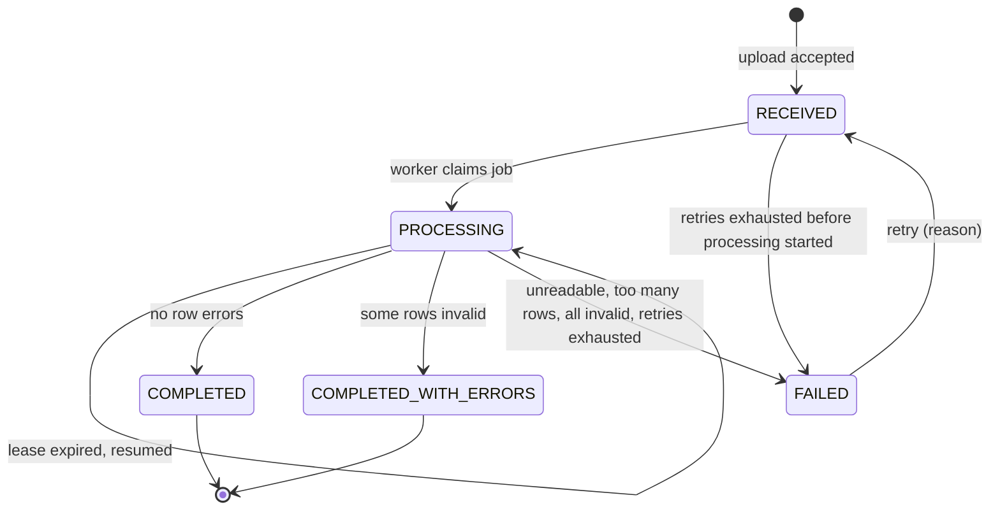
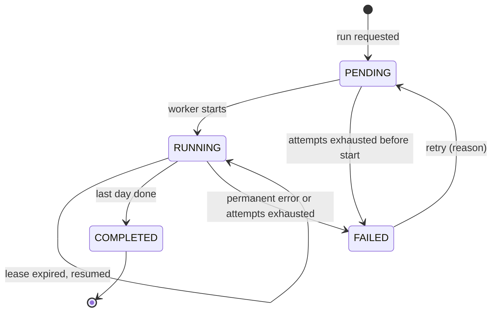
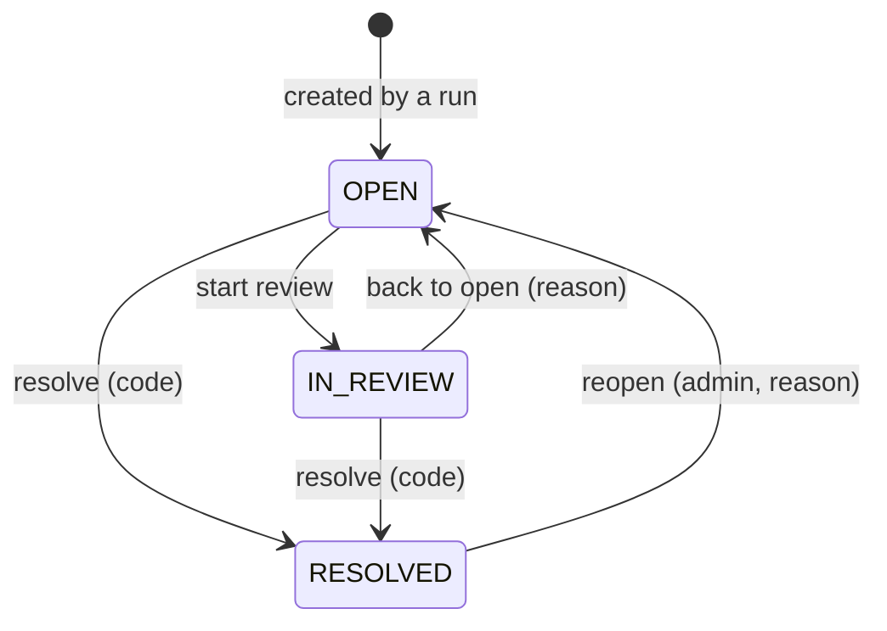
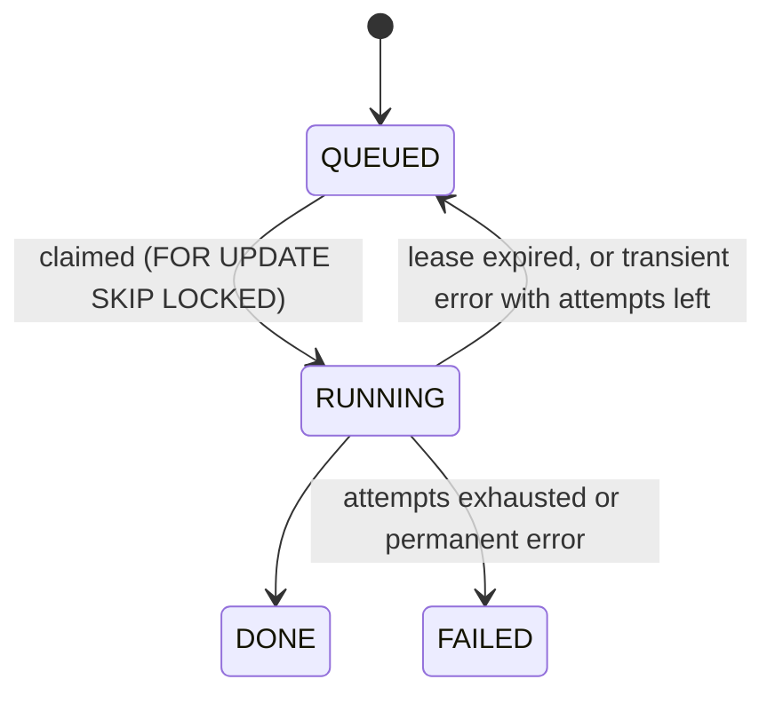

# Reconciliation rules (v1)

**Status:** Accepted for v1 · **Tasks:** TASKS.md M1.5–M1.8 · **Date:** 2026-11-16

The rulebook for the importer and the engine. Every rule has an ID so tests can name it (M5.21 has one test per normalization rule; M6.18 and M6.19 check the outcome rules). **If the code and this document disagree, the document wins and the code is the bug**, unless the document is changed first, on purpose, in its own commit.

Rule ID prefixes: **N** normalization, **P** participation, **O** outcomes, **D** duplicates, **K** discrepancy keys, **MN** money.

---

## 1. Normalization

Source files are messy: `" pay-106 "`, `"PAY-106"` and `"Pay-106"` are the same payment. Normalization produces a canonical value for comparison while the raw value is kept untouched. We need both: the normalized value to match on, and the raw value to show an investigator exactly what the file said. That is why `transaction_record` has `raw_reference`, `normalized_reference` and `raw_values`.

Normalization runs only on rows that passed validation ([requirements.md §7](requirements.md#7-csv-file-contracts)). Both sources are normalized by the same code with the same rules; a rule that applied to one source only would make the same payment look different on each side.

| ID | Field | Rule | Example |
|---|---|---|---|
| N1 | reference | Trim leading and trailing whitespace, including non-breaking space U+00A0 and other Unicode spaces (`String.strip()`, not `trim()`) | `" pay-106 "` → `"pay-106"` |
| N2 | reference | Unicode NFKC normalization | full-width `ＰＡＹ－１０６` → `PAY-106` |
| N3 | reference | Upper-case with `Locale.ROOT`, never the JVM's default locale | `pay-106` → `PAY-106` |
| N4 | reference | Internal characters are **not** removed or changed in v1: no stripping of hyphens, spaces or leading zeros | `PAY-101` and `PAY101` stay different references |
| N5 | currency | Trim, upper-case (`Locale.ROOT`); must be a valid ISO-4217 code | `aed` → `AED` |
| N6 | amount | Parse with `new BigDecimal(String)`, never via `double`; reject more than 4 decimal places; store at scale 4 | `120.5` → `120.5000` |
| N7 | timestamp | `transaction_at` is parsed as an `OffsetDateTime` and stored as a UTC instant (`TIMESTAMPTZ`). `transaction_date` = `transaction_at` converted to UTC, then `.toLocalDate()` | `2026-10-01T02:00+04:00` → instant `2026-09-30T22:00Z`, date `2026-09-30` |
| N8 | date only | If only `transaction_date` is given (ledger only), use it as is; `transaction_at` is NULL. If both are given, `transaction_at` wins and the file's `transaction_date` is ignored (it stays in `raw_values`) | `2026-10-01` → date `2026-10-01` |
| N9 | status | Map with the table below, case-insensitively after trimming; anything else is row error `UNKNOWN_STATUS` | `captured` → `SUCCESS` |
| N10 | transaction_type | Trim and upper-case; must be `PAYMENT`, `REFUND`, `CHARGEBACK` or `FEE`; blank or missing column → `PAYMENT`; anything else is row error `UNKNOWN_TRANSACTION_TYPE` | `refund` → `REFUND` |
| N11 | raw values | The original row is stored unchanged as JSON in `raw_values`, keyed by the original header text, values as the original strings. `raw_reference` is the reference exactly as in the file, untrimmed | `{"reference": " pay-106 ", "amount": "120.5", …}` |

**Status mapping (N9), both sources:**

| Normalized | Accepted source values (any case) |
|---|---|
| `SUCCESS` | `success`, `succeeded`, `captured`, `settled`, `paid`, `completed` |
| `PENDING` | `pending`, `processing`, `authorized` |
| `FAILED` | `failed`, `declined`, `error` |
| `REVERSED` | `reversed`, `refunded`, `voided`, `cancelled` |

The four normalized values are exactly the `transaction_record.status` CHECK constraint. Source-specific synonyms that aren't in this table (a gateway that writes `sale`) are not added here; they belong to per-organization mappings in v2.

**Why each rule:**

- **N1–N3.** Spaces, full-width characters and case are formatting noise that a human ignores without thinking. NFKC is what turns a full-width `Ｐ` or a non-breaking space into its plain form. `Locale.ROOT` matters because upper-casing `i` on a Turkish-locale JVM gives a dotted `İ`, and the reference would silently stop matching.
- **N4.** Over-normalizing creates **false matches**, which are worse than missed ones: a false match hides a discrepancy, while a missed match at least surfaces as an exception someone looks at. If `PAY101` and `PAY-101` really are the same payment, that's a mapping problem for v2, not something to guess.
- **N7, the timezone rule.** A payment at 02:00 Dubai time (+04:00) on 1 October is 22:00 UTC on **30 September**. If the ledger used its local date and the gateway used UTC, the same payment would land on different dates, and near a period boundary it would be reported missing on both sides. Converting both sources to UTC with the same code puts every record on one clock. The partition a record lands in is chosen by the same date. Sample PAY-202 ([samples/README.md §3](samples/README.md#3-ledger-currency-mismatchcsv--gateway-currency-mismatchcsv)) shows the case.
- **N8.** A ledger that only knows dates can't be converted to UTC, because there's no time to convert. Taking the date as is, is the only honest option; the cost is that a date-only ledger and a timestamped gateway can disagree by a day for payments near midnight UTC. A run whose period covers both days still matches them (§3).
- **N11.** Keeping the original row means a normalization bug can be fixed and the data replayed, instead of the bug being baked into the stored data forever.

---

## 2. Which records take part in a run

A run has an organization, a period `[period_start, period_end]` (both inclusive), a currency, and two sources (`left_source`, `right_source`; by default the ledger and the gateway).

The engine works on **groups**: all records that share `(normalized_reference, transaction_type)`. A record **takes part** in a run when all of these hold:

| ID | Condition | Why |
|---|---|---|
| P1 | `organization_id` equals the run's organization | Tenancy |
| P2 | `source_type` is the run's left or right source | v1 has two sources, so this is every record |
| P3 | Its import batch is `COMPLETED` or `COMPLETED_WITH_ERRORS` | Rows of a batch still `PROCESSING`, or one that `FAILED`, aren't accepted records yet; a retry may delete them |
| P4 | `status = SUCCESS` | Only completed money movements are reconciled |
| P5 | Its **group** contains at least one record (passing P1–P4 and P6) in the run's currency | A run is pinned to one currency ([ADR 0009](adr/0009-run-pinned-to-one-currency.md)). Records in other currencies take part only as the other half of a currency mismatch |
| P6 | `transaction_date` is within `[period_start, period_end]` | The run's period |

A record that fails P4 or P5 but passes P1–P3 and P6 is **excluded**: counted in the run report (`reconciliation_run.excluded_count`, the summary's `excluded`), never silently dropped. A record outside the period or in another organization simply isn't part of the run at all.

P5 is evaluated on the group, not on each record, so that a ledger record in AED and a gateway record in USD with the same reference end up in the same group. Filtering records by currency first would split them into an AED-only and a USD-only group, and the run would report two misleading "missing" cases instead of one currency mismatch.

A ledger `SUCCESS` against a gateway `FAILED` for the same reference is a real discrepancy (the gateway declined a payment the business thinks succeeded). The `FAILED` record is excluded by P4, so the ledger record becomes `MISSING_IN_GATEWAY` with reason code `COUNTERPART_NOT_SUCCESS` (§5), which tells the investigator what happened.

---

## 3. The match key

Two records are candidates for each other when:

- they have the same `(normalized_reference, transaction_type)`;
- both take part in the run (§2);
- they come from opposite sources.

**The currency is not part of the grouping key**, on purpose: grouping by reference and type, then checking currencies, is what lets the engine see a currency mismatch at all (§4, O2).

**The transaction type is part of the key.** A `PAYMENT` and a `REFUND` with the same reference are separate groups, matched only like-for-like. Linking a refund to its payment is v2 work.

**The transaction date is not part of the key.** A payment dated 1 October in the ledger and 2 October in the gateway (a cross-midnight timestamp, or a late file) still matches if both dates fall inside the run period. If the counterpart is **outside** the period, the record is reported missing. A later run with a wider period will match it, and the earlier case can then be resolved with `TIMING_DIFFERENCE`. Configurable settlement windows that look beyond the period are v2.

Why not include the date: settlement lag and timezone edges routinely put the two halves of one payment on different days. With the date in the key, every such payment would be two false exceptions.

---

## 4. Outcomes, evaluated in order

For each group, the first rule that applies decides the outcome. The order **is** the precedence, and it's a business decision, not an implementation detail.

| ID | Rule | Outcome |
|---|---|---|
| O1 | Either side has more than one record in the group, **or** any record in the group was flagged as a within-file duplicate at import (D1) | One `DUPLICATE_IN_SOURCE` case linking **every** record in the group, both sides. No record in the group is matched or reported missing |
| O2 | The group's records are in more than one currency | One `CURRENCY_MISMATCH` case linking both records |
| O3 | One record on each side, `amount.compareTo(other) != 0` | One `AMOUNT_MISMATCH` case linking both records, with `amount_difference = gateway − ledger`. **Never counted as matched** |
| O4 | One record on each side, equal amounts (by `compareTo`) | A `reconciliation_match` row: `match_type = EXACT`, `amount_difference = 0` |
| O5 | Only one side has a record | `MISSING_IN_GATEWAY` (only the ledger has it) or `MISSING_IN_LEDGER` (only the gateway has it) |

Why this order:

1. **Duplicates first.** If a side has two candidates, nothing else about the group can be trusted: which of the two gateway rows would you compare amounts with?
2. **Currency next.** Amounts in different currencies can't be compared.
3. **Then the one-to-one cases**, decided by amount.
4. **Then the one-sided cases.**

The missing types are named by **source**, not by side: a ledger-only group is `MISSING_IN_GATEWAY` whichever source is the run's left source.

### Duplicates

| ID | Rule |
|---|---|
| D1 | **At import**, every row of a batch that shares `(normalized_reference, transaction_type, amount, currency)` with another row of the same batch gets `is_duplicate_in_source = true`. All copies are flagged; none is dropped; none is a row error. Amounts are compared by value |
| D2 | **In a run**, the engine counts the candidates on each side of a group itself (O1). This catches what D1 can't: the same reference with different amounts in one file, and the same settlement imported twice in two different files (one extra row changes the content hash, so both files are accepted, and every reference then has two records) |

**How D1 is computed (M5.13).** Not in Java: a full-file check would have to remember every row of a streamed file. Once every chunk of a batch is committed, one set-based `UPDATE … WHERE (normalized_reference, transaction_type, amount, currency) IN (SELECT … GROUP BY … HAVING count(*) > 1)` runs in the batch's finishing transaction; PostgreSQL spills the grouping to disk if it must, and the JVM holds nothing. `amount` is `NUMERIC`, so `250.0000 = 250.0000` by value.

A D1 flag travels with the record: if one copy falls inside a run's period and the other outside it, the in-period copy still makes its group a duplicate. The flag says "this file contained this payment more than once", which is worth a human's attention whichever run sees it.

### Tie-breaking

**There is none.** Whenever a choice would be arbitrary (two candidates for one record), the rules raise an exception for a human instead of choosing. "Take the first one" in a financial system silently hides a possible double charge or a double booking. Surfacing ambiguity, not resolving it, is the engine's job.

### The invariant (NFR-01)

Every record that takes part in a run ends in **exactly one** of: matched, amount mismatch, currency mismatch, missing, or duplicate. Every excluded record is counted as excluded. So, for the records of a run's organization, sources and period:

```
records in = matched × 2
           + amount-mismatch cases × 2
           + currency-mismatch cases × 2
           + missing cases
           + records linked to duplicate cases
           + excluded records
```

The M6.19 property test checks this with random record sets, and [samples/README.md](samples/README.md) checks it by hand for every sample run.

---

## 5. Exception types and reason codes

### 5.1 Exception types

The closed list. It is exactly the `exception_case.type` CHECK constraint in V1; adding a type means a migration and a change here.

| Type | Raised when | Records linked | `amount` | `amount_difference` |
|---|---|---|---|---|
| `MISSING_IN_GATEWAY` | A ledger record with no gateway counterpart (O5) | 1 ledger | Ledger amount | NULL |
| `MISSING_IN_LEDGER` | A gateway record with no ledger counterpart (O5) | 1 gateway | Gateway amount | NULL |
| `AMOUNT_MISMATCH` | One record each side, amounts differ (O3) | 1 + 1 | Ledger amount | gateway − ledger |
| `CURRENCY_MISMATCH` | Same reference and type, different currencies (O2) | 1 + 1 | Ledger amount | NULL |
| `DUPLICATE_IN_SOURCE` | More than one record for the group on either side, or a D1 flag (O1) | Every record in the group | Smallest ledger amount; if no ledger record, smallest gateway amount | NULL |

`amount` is "the amount at stake": the ledger's figure when there is one, because the ledger is the business's own record of what it expected. It drives amount filters and totals. For a duplicate it is a representative value for filtering, **not** a total of the linked records. (`exception_case.amount` is added by the M6 migration; V1 has only `amount_difference`.)

`amount_difference` sign convention: **gateway − ledger**. Negative means the gateway paid less than the ledger expected. PAY-103: `700.00 − 750.00 = −50.00`.

`exception_case.currency` is the currency of the run that created the case.

### 5.2 Reason codes

`reason_code` is an optional sub-classification set by the engine when it knows more than the type says. It is `NULL` otherwise. There is no CHECK constraint on it; the engine is the only writer.

| Reason code | Used with | Set when |
|---|---|---|
| `COUNTERPART_NOT_SUCCESS` | `MISSING_IN_GATEWAY`, `MISSING_IN_LEDGER` | The other source has a record with the same reference and type in the run's period, but its status isn't `SUCCESS` (it was excluded by P4). E.g. the gateway declined a payment the ledger recorded as paid |
| `SAME_AMOUNT` | `DUPLICATE_IN_SOURCE` | Every record in the group has the same amount. Suggests a repeated export row or a double booking |
| `DIFFERENT_AMOUNTS` | `DUPLICATE_IN_SOURCE` | The group's records have at least two different amounts. Suggests partial captures, split settlements, or two different payments sharing a reference |

### 5.3 Resolution codes

A resolution code is required to resolve a case and is validated against this list. Some codes also require a note, because the code alone doesn't explain enough for an auditor. The list lives in one Java enum (`ResolutionCode`, M7.1) with a `noteRequired` flag. `exception_case.resolution_code` has no CHECK constraint in v1, so adding a code is a code change and a change to this table; a CHECK could be added later as defense in depth, at the cost of a migration per new code.

| Code | Meaning | Note required? |
|---|---|---|
| `TIMING_DIFFERENCE` | The counterpart arrives in a later period (or was outside this run's period) | No |
| `GATEWAY_FEE` | The difference is a fee deducted by the gateway | No |
| `DATA_ENTRY_ERROR` | A source record was wrong and has been corrected upstream | Yes |
| `DUPLICATE_CONFIRMED` | A genuine double charge, refunded or being refunded | Yes |
| `DUPLICATE_FILE_ARTIFACT` | The duplicate was caused by the provider's export, not a real double charge | No |
| `WRITTEN_OFF` | An accepted, approved loss | Yes |
| `FALSE_POSITIVE` | Not a real discrepancy | Yes |
| `OTHER` | Anything else | Yes |

Who may resolve: anyone with `EXCEPTION_RESOLVE` (investigators and org admins). The resolver doesn't have to be the assignee in v1; "only the assignee or an admin may resolve" is a possible later rule.

---

## 6. Discrepancy identity (`discrepancy_key`)

Every case carries a deterministic key that identifies the **discrepancy**, not the run that found it:

```
<TYPE>:<normalized_reference>:<transaction_type>:<sorted currencies joined by '/'>

AMOUNT_MISMATCH:PAY-103:PAYMENT:AED
CURRENCY_MISMATCH:PAY-201:PAYMENT:AED/USD
DUPLICATE_IN_SOURCE:PAY-104:PAYMENT:AED
```

| ID | Rule | Why |
|---|---|---|
| K1 | The key is built from the type, the group's normalized reference and transaction type, and the **sorted set** of currencies in the group | The transaction type is in it because a `PAYMENT` and a `REFUND` with the same reference are different groups and can be different discrepancies |
| K2 | The key contains **no run ID and no period** | Re-running reconciliation, or running an overlapping period ("1–31 Jan" then "15 Jan–15 Feb"), computes the same key for the same problem. Because the currency part is the sorted set, the AED run and the USD run both compute `…:AED/USD` for one currency mismatch |
| K3 | At most one **active** (`OPEN` or `IN_REVIEW`) case per `(organization_id, discrepancy_key)`. A run that finds an active case with its key doesn't create another; it links the case to itself (`exception_case_run`, added in M6) and links any records not yet linked | Enforced by the partial unique index `exception_case_active_uk … WHERE status <> 'RESOLVED'`, so even two concurrent runs can't both insert one |
| K4 | If the only case with the key is `RESOLVED`, a run that sees the discrepancy again creates a **new `OPEN` case**. The old case and its resolution stay untouched | A resolution says "we dealt with what we saw then". The discrepancy still being there in a new run means someone should look again |

**Parsing.** A reference may itself contain `:`. The key is still unambiguous: the type, the transaction type and the currency set never contain `:`, so read the first field from the left and the last two from the right. Nothing is escaped.

**When the outcome changes between runs.** Suppose PAY-103 later matches, because the gateway sent a corrected record. The open `AMOUNT_MISMATCH:PAY-103:PAYMENT:AED` case is **not** auto-resolved in v1. The run report lists "open cases whose discrepancy no longer reproduces" (active cases with no link to the latest run that covered their records), and an investigator resolves them, typically with `DATA_ENTRY_ERROR`. Auto-resolution is a v2 candidate: it's convenient, but a system that closes financial exceptions on its own needs its own audit and approval rules.

The same applies when the type changes: if a missing record's counterpart arrives, the old `MISSING_IN_GATEWAY:…` case stays open and the new run raises whatever the group now is (a match, or a new `AMOUNT_MISMATCH:…` with a different key).

If K4 proves noisy (a written-off item re-raised by every overlapping run), the v2 fix is to suppress re-raising when the latest resolution is terminal, such as `WRITTEN_OFF`. Not built in v1.

---

## 7. State machines

Each table lists **every** allowed transition. Anything not listed is rejected with `409 invalid-transition` (the body carries the current status). Each machine is enforced in exactly one place in the code (M5.15 `ImportBatchStatus`, M6.10 `RunLifecycle`, M7.5 the exception transition table), and every audited transition writes its audit event in the same transaction as the change (`AuditService.record`, `Propagation.MANDATORY`).

"Who" is a permission from [plans/authentication.plan §5](../plans/authentication.plan), never a role name, or "system" for the worker. The state names are exactly the CHECK constraint values in V1.

### 7.1 Import batch

`import_batch.status`: `RECEIVED`, `PROCESSING`, `COMPLETED`, `COMPLETED_WITH_ERRORS`, `FAILED`.



| From | To | Triggered by | Reason? | Audit event |
|---|---|---|---|---|
| — | `RECEIVED` | `IMPORT_CREATE` (`POST /imports`) | No | `IMPORT_RECEIVED` |
| `RECEIVED` | `PROCESSING` | System: a worker claims the job | No | — (logged, not audited) |
| `PROCESSING` | `COMPLETED` | System: every row valid | No | `IMPORT_COMPLETED` |
| `PROCESSING` | `COMPLETED_WITH_ERRORS` | System: ≥ 1 row error and ≥ 1 valid row | No | `IMPORT_COMPLETED` (payload carries the status and counts) |
| `PROCESSING` | `FAILED` | System: unreadable file (encoding), more than 500,000 rows, every row invalid, file missing from storage, or job attempts exhausted | `failure_reason` | `IMPORT_FAILED` |
| `RECEIVED` | `FAILED` | System: the job ran out of attempts before processing ever started (every claim failed transiently, or each worker died before its first transaction committed) | `failure_reason` | `IMPORT_FAILED` |
| `PROCESSING` | `PROCESSING` | System: the sweeper re-queues the job after an expired lease; the next worker resumes after `last_committed_row` | No | — |
| `FAILED` | `RECEIVED` | `IMPORT_CREATE` (`POST /imports/{id}/retry`) | Yes | `IMPORT_RETRY_REQUESTED` |

`COMPLETED` and `COMPLETED_WITH_ERRORS` are terminal. A completed import is never re-run or replaced in v1 ([ADR 0005](adr/0005-duplicate-import-policy.md)).

The `PROCESSING → PROCESSING` row isn't a status change: it's listed so nobody "fixes" a resumed job by moving it back to `RECEIVED`. A retry from `FAILED` reprocesses from scratch: in the same transaction it deletes the batch's records and row errors, resets the counters and the checkpoint, and enqueues a new job (M5.20). That is safe because rows of a `FAILED` batch were never accepted (P3), so no run has used them.

### 7.2 Reconciliation run

`reconciliation_run.status`: `PENDING`, `RUNNING`, `COMPLETED`, `FAILED`.



| From | To | Triggered by | Reason? | Audit event |
|---|---|---|---|---|
| — | `PENDING` | `RUN_CREATE` (`POST /reconciliation-runs`) | No | `RUN_REQUESTED` |
| `PENDING` | `RUNNING` | System: a worker claims the job | No | `RUN_STARTED` |
| `RUNNING` | `RUNNING` | System: job re-delivered after a crash or expired lease; resumes after `last_completed_date` | No | — (not a transition) |
| `RUNNING` | `COMPLETED` | System: the last day of the period is done | No | `RUN_COMPLETED` (payload: summary) |
| `RUNNING` | `FAILED` | System: a non-retryable error, or the job runner gave up after `max_attempts` | `failure_reason` | `RUN_FAILED` |
| `PENDING` | `FAILED` | System: the job ran out of attempts before the run ever started (every claim failed transiently); the same reason imports have `RECEIVED → FAILED` | `failure_reason` | `RUN_FAILED` |
| `FAILED` | `PENDING` | `RUN_CREATE` (`POST /reconciliation-runs/{id}/retry`) | Yes | `RUN_RETRY_REQUESTED` |

**One active run per scope.** At most one run per organization, period, sources and currency can be `PENDING` or `RUNNING` at a time, enforced by the partial unique index `reconciliation_run_active_scope_uk` (M6). A request or a retry that would make a second one active gets `409 run-in-progress` with `existingRunId`. Runs over *overlapping* scopes may run at once: they are safe by construction (K3, and cases are inserted in key order).

**Waiting for imports.** A run isn't requested (`409 import-in-progress`) while an import of the organization is `RECEIVED` or `PROCESSING`, and a `PENDING` run's job doesn't start while one is: it is deferred a minute without spending an attempt.

`COMPLETED` is terminal. To reconcile the same period again (say, after a late gateway file), the client starts a new run with a fresh `Idempotency-Key` ([ADR 0006](adr/0006-reconciliation-run-idempotency.md)). A retried run keeps `last_completed_date` and skips the days it had already committed, so it never duplicates their matches. There is no `CANCELLED` state in v1: every state needs tests, permissions and audit, so it gets added when a user needs it.

### 7.3 Exception case

`exception_case.status`: `OPEN`, `IN_REVIEW`, `RESOLVED`.



| From | To | Who (permission) | Reason? | Audit event |
|---|---|---|---|---|
| — | `OPEN` | System (the engine, through `DiscrepancyRecorder`) | No | `EXCEPTION_CREATED` |
| `OPEN` | `IN_REVIEW` | `EXCEPTION_UPDATE` | No | `EXCEPTION_STATUS_CHANGED` |
| `IN_REVIEW` | `OPEN` | `EXCEPTION_UPDATE` | Yes | `EXCEPTION_STATUS_CHANGED` |
| `OPEN` or `IN_REVIEW` | `RESOLVED` | `EXCEPTION_RESOLVE` | Resolution code, plus a note where §5.3 requires one | `EXCEPTION_RESOLVED` |
| `RESOLVED` | `OPEN` | `EXCEPTION_REOPEN` (org admins only) | Yes | `EXCEPTION_REOPENED` |
| `OPEN` or `IN_REVIEW` | same | `EXCEPTION_UPDATE`: change of assignee | No | `EXCEPTION_ASSIGNED` |
| any | same | `EXCEPTION_UPDATE`: note added | — (the note is the content) | `EXCEPTION_NOTE_ADDED` |

Rules that go with the table:

- **Every status change** also writes an `exception_status_history` row (from, to, reason, actor), so "what happened to this case?" is a query, not an audit-log parse. Assignments and notes are audited but don't change the status.
- **Resolving** sets `resolution_code`, `resolution_note`, `resolved_by` and `resolved_at` together. V1's CHECK constraint requires them to be set exactly when the status is `RESOLVED`.
- **Reopening** clears those four fields (the same CHECK requires it). The earlier resolution survives in `exception_status_history`, whose reopen row also carries the previous code and note, so a reopen never erases history.
- **Assigning a resolved case** is rejected (`409 invalid-transition`): reopen it first. The assignee must be a member of the same organization with `EXCEPTION_UPDATE`.
- **Reopen collision.** If a later run created a new active case with the same `discrepancy_key` while this one was resolved (K4), reopening would make two active cases for one key, which `exception_case_active_uk` forbids. The reopen is rejected with `409 active-case-exists`, pointing to the existing case.
- **Concurrent edits** are caught by optimistic locking: every state change and assignment needs the current version in `If-Match` ([ADR 0007](adr/0007-optimistic-locking-on-exceptions.md)). Adding a note doesn't change the case row, so it needs no version and two people can add notes at once.
- `RESOLVED → RESOLVED` isn't in the table, so resolving twice is rejected by the transition check, and if two resolves race, optimistic locking makes exactly one win.
- **One place in the code** (M7.5): the `Transition` enum is this table as data (from-states, target, permission, reason rule, audit action), and `ExceptionStateMachine` is the only code that changes a case, assignments included (an ArchUnit rule names it). It checks, in order, the transition (`409 invalid-transition`), the permission (`403`, repeating the endpoint's annotation on purpose) and the reason rule (`400`). Checking the transition first tells a caller without the permission the case's status, which every role can read anyway.
- **Assignees** must be *active* members of the organization whose role grants `EXCEPTION_UPDATE`; a disabled user can't be given work.
- **Re-running reconciliation never changes a case's workflow state.** An active case the run finds again is linked to the run (`exception_case_run`) and gets any new records linked, but its status, assignee, resolution and version are untouched, so a re-run never makes an investigator's `If-Match` stale. A resolved case is never reopened or changed by the engine: if its discrepancy is still there, the run creates one new `OPEN` case (K4), and the next run re-observes that one instead of creating a third. Reopening the old case is then `409 active-case-exists` with `existingCaseId`; the admin decides which investigation continues, nothing is merged automatically.
- **Who may resolve**: anyone with `EXCEPTION_RESOLVE`; resolving doesn't unassign. A blank note on a code that doesn't need one is stored as no note.

### 7.4 Job (internal)

`job.status`: `QUEUED`, `RUNNING`, `DONE`, `FAILED`. Not exposed through the API and not audited; observable through metrics (M9.9).



| From | To | Triggered by |
|---|---|---|
| — | `QUEUED` | The same transaction that creates the batch or run |
| `QUEUED` | `RUNNING` | A worker claims it, sets `locked_by` and `lease_until` (V1's CHECK requires both while `RUNNING`) |
| `RUNNING` | `DONE` | The handler finished |
| `RUNNING` | `QUEUED` | The sweeper found an expired lease, or a transient error with attempts left; `run_after` is backed off exponentially |
| `RUNNING` | `FAILED` | Attempts exhausted, or a permanent error (validation-type failures are never retried) |

When a job ends `FAILED`, its handler moves the business entity (batch or run) to `FAILED` in the same transaction. A retry of the business entity creates a **new** job row; the failed one stays for history. Details: [scalability.md §4](scalability.md#4-background-processing) and [ADR 0004](adr/0004-postgresql-job-queue.md).

---

## 8. Money handling

Binary floating point can't represent most decimal fractions exactly: in a `double`, `0.1 + 0.2` is `0.30000000000000004`. Money therefore never touches `float` or `double` anywhere in ReconFlow.

| ID | Rule | Reason |
|---|---|---|
| MN1 | Java type `BigDecimal`; database type `NUMERIC(19,4)` | 15 integer digits covers any realistic single transaction; 4 decimal places covers every ISO-4217 currency (the most is 3 minor units, e.g. KWD, BHD) with headroom for computed differences. `NUMERIC` arithmetic in PostgreSQL is exact |
| MN2 | Compare with `compareTo(...) == 0`, never `equals` | `BigDecimal.equals` compares the scale too: `new BigDecimal("1000.0").equals(new BigDecimal("1000.00"))` is `false`. Sample PAY-105 (`300.00` vs `300.0`) is the regression case, and an ArchUnit rule forbids `BigDecimal.equals` in production code (M6.22) |
| MN3 | Parse from the **string** in the CSV with `new BigDecimal(text)`; never `Double.parseDouble` or `BigDecimal.valueOf(double)` | A `double` can't hold `0.1` exactly, so going through one corrupts the amount before it's even stored |
| MN4 | Inputs with more than 4 decimal places are rejected (`AMOUNT_SCALE_EXCEEDED`). Valid amounts are stored with `setScale(4, RoundingMode.UNNECESSARY)` | `UNNECESSARY` throws instead of rounding. Silently changing a financial amount is worse than refusing it: a rejected row is visible and fixable, a rounded one isn't |
| MN5 | Amounts aren't checked against the currency's minor units in v1 (`JPY 100.50` is accepted) | Some ledgers carry sub-unit precision (averaged costs, fractional fees). Flagged as a possible v2 rule |
| MN6 | Sums are computed in SQL (`SUM(amount)` on `NUMERIC`); differences as `gateway − ledger` on two `NUMERIC` / `BigDecimal` values | Exact by construction, and no rows are loaded into Java just to add them up |
| MN7 | JSON carries amounts as **strings** in plain notation with the stored scale (`"1000.0000"`), always next to a `currency` field; never as JSON numbers | JavaScript (and many JSON libraries) parse numbers into binary doubles, so a large or precise amount is silently changed on arrival. A string is lossless. Configured once in the Jackson setup (M2) |
| MN8 | Format output with `toPlainString()`, never `toString()` | `toString()` can produce scientific notation, e.g. `new BigDecimal("1E+3").toString()` is `"1E+3"` |

**No rounding anywhere in v1.** All inputs have at most 4 decimal places, and adding or subtracting values of scale 4 gives a value of scale 4, so no operation ever needs a rounding mode. If v2 adds FX conversion or fee percentages, that's when a rounding rule (and its `RoundingMode`) has to be chosen and written here.

**Amounts are positive** (assumption A8). Direction comes from `transaction_type`, not from a sign, and `amount_difference` is the only value that can be negative.

**How do you store and compare money, in one breath:** `BigDecimal` in Java and `NUMERIC(19,4)` in PostgreSQL, parsed from the original string, rejected rather than rounded if it has more than four decimals, compared with `compareTo` because `equals` treats `1000.0` and `1000.00` as different, summed in SQL, and sent over JSON as strings.

---

## 9. Worked examples

The full set, with the expected outcome of every record in every sample file, is in [samples/README.md](samples/README.md).

The README's illustrative example (projectoverview.md §1), read with these rules as a one-day run in INR where every record is `SUCCESS` and `PAYMENT`:

| Reference | Ledger | Gateway | Outcome | Rule |
|---|---|---|---|---|
| TXN-101 | 1,000.00 | 1,000.00 | Matched | O4 |
| TXN-102 | 500.00 | — | `MISSING_IN_GATEWAY`, amount 500.00 | O5 |
| TXN-103 | 750.00 | 700.00 | `AMOUNT_MISMATCH`, difference −50.00 | O3 |
| TXN-104 | 250.00 | 250.00 ×2 | `DUPLICATE_IN_SOURCE`, 3 records, reason `SAME_AMOUNT` | O1 |
| TXN-105 | 300.00 | 300.00 | Matched | O4 |

Summary: matched 2 (1,300.00) · amount mismatch 1 (net −50.00) · missing in gateway 1 (500.00) · missing in ledger 0 · duplicate cases 1. Invariant: 10 records (5 ledger, 5 gateway) = 2×2 + 1×2 + 1 + 3 + 0.

The README calls TXN-102 "Unmatched"; in these rules that is `MISSING_IN_GATEWAY`.
